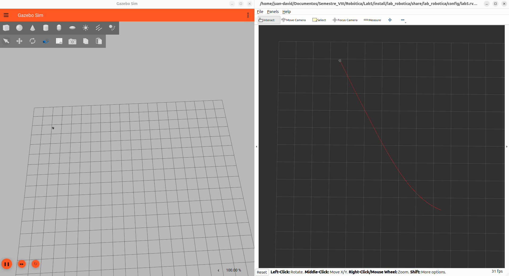
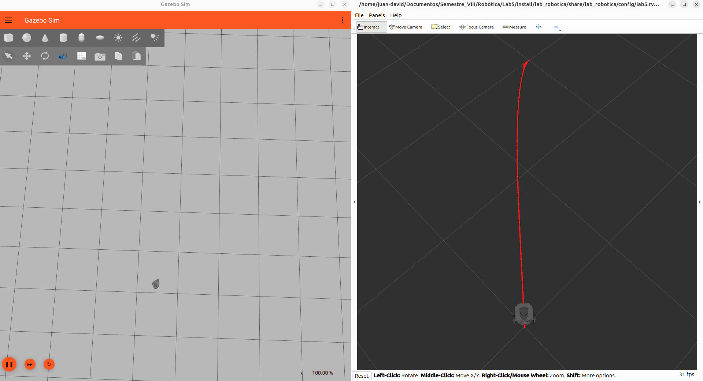

# Guion y defensa — Laboratorio 5 (Cap. 4)

Por diapositiva: **qué va en la slide** y **qué hay que saber para exponerla**.

---

## Diapositiva 1 — Portada

**En la diapositiva**

**Laboratorio 5 — Cap. 4: seguimiento de línea, Pure Pursuit y punto objetivo en el TurtleBot3**

- Juan David Villota
- Jhon Hesneyder Londoño

Robótica · ROS2 Lyrical · Gazebo 10.5 · TurtleBot3 burger

**Qué hay que saber**

- Las tres actividades de la guía están resueltas en **Python puro** con el modelo bicicleta. Aquí se llevan al **TurtleBot3 simulado**, que es un **robot diferencial**. Ese cambio de modelo es el hilo de toda la exposición.
- Diferencia central que hay que poder decir de memoria: en la guía la entrada de control es el **ángulo de dirección `δ`**; en el diferencial la única entrada de giro es la **velocidad angular `ω`**, porque `θ' = ω` en vez de `θ' = v·tan δ/L`.
- Dato numérico para comparar: la `v` de la guía era la misma, pero el TurtleBot3 no puede girar en el sitio con `v = 0` en estas leyes (eso requeriría el caso `ω` puro, que no se usa).

---

## Diapositiva 2 — Qué se hizo

**En la diapositiva**

Se pasaron las actividades 3, 4 y 5 de Python puro al **TurtleBot3** en ROS2 + Gazebo.

**Estructura del código** (un paquete, tres nodos):

```
src/lab_robotica/
├── lab_robotica/act3_linea_turtlebot3.py
├── lab_robotica/act4_pure_pursuit_turtlebot3.py
├── lab_robotica/act5_go_to_goal.py
├── config/lab5.rviz
└── launch/lab5.launch.py
```

Los tres nodos tienen la misma interfaz: leen la pose de **`/odom`** y publican el comando en **`/cmd_vel`**. Solo cambia el problema de control.

**El launcher**: un comando levanta todo (Gazebo + robot + nodo + RViz) y elige la actividad.

```bash
ros2 launch lab_robotica lab5.launch.py actividad:=3   # 4 o 5
```

**Qué hay que saber — estructura de un nodo ROS2**

Los tres nodos son **la misma plantilla** con la ley de control cambiada. Hay que poder describirla sin mirar el código:

| Línea | Qué hace | Por qué |
|---|---|---|
| `class X(Node)` + `super().__init__('nombre')` | registra el nodo en el grafo con ese nombre | el nombre es como lo ven `ros2 node list` y los `remap` |
| `create_publisher(TwistStamped, '/cmd_vel', 10)` | abre el canal de salida | el **10 es la profundidad de la cola QoS**, no un ID |
| `create_subscription(Odometry, '/odom', self.odom_callback, 10)` | abre el canal de entrada | el tipo debe coincidir con el que publica el puente |
| `create_timer(0.1, self.control)` | lazo de control a **10 Hz** | el control corre a ritmo fijo, **no** cuando llega un mensaje |
| `rclpy.spin(node)` | cede el hilo al ejecutor de callbacks | sin `spin` no se ejecuta ningún callback |

- **Separación percepción / control (el patrón clave).** El callback `odom_callback` **solo guarda el estado** (`self.x`, `self.y`, `self.theta`) y devuelve. El que **decide** es `self.control`, disparado por el timer. Por eso el lazo no depende de cuándo llega `/odom`: si llegaran dos mensajes seguidos o ninguno, el control sigue corriendo a 10 Hz con la última pose conocida.
- **`main()`**: `rclpy.init()` → construir el nodo → `spin` → `destroy_node()` → `rclpy.shutdown()`. Es el orden obligatorio.
- **`TwistStamped`, no `Twist`**: el mensaje es un `Twist` **con `header`**. El puente `ros_gz` del TurtleBot3 espera la versión *stamped*. El `header.stamp` se llena con `self.get_clock().now().to_msg()` (reloj de simulación) y `header.frame_id = 'base_link'`.
- **Por qué el mismo código serviría en el robot real**: mismo tópico (`/cmd_vel`), mismo mensaje, misma cinemática. Lo único que cambia es quién está del otro lado — el plugin de Gazebo o el driver del robot.
- **`self.x`/`self.y` arrancan en 0** y el timer ya publica desde el primer ciclo, antes de que llegue el primer `/odom`. Es correcto porque el robot efectivamente nace en el origen.

**Qué hay que saber — el launcher (por encima)**

- Un `launch` es una `LaunchDescription` con **acciones**. Los argumentos se declaran con `DeclareLaunchArgument('actividad', ...)` y se leen con `LaunchConfiguration('actividad')`.
- El diccionario `NODOS = {'3': ..., '4': ..., '5': ...}` traduce el número a ejecutable. Se resuelve con **`OpaqueFunction`**, es decir **en tiempo de lanzamiento**, porque un `Node` normal necesita el nombre del ejecutable ya resuelto. Si la actividad no existe, levanta `RuntimeError`.
- `SetEnvironmentVariable('TURTLEBOT3_MODEL', 'burger')`: **sin esta variable el launch de TurtleBot3 aborta** con `Caught exception in launch: 'TURTLEBOT3_MODEL'`.
- **Servidor y GUI de Gazebo son dos `ExecuteProcess` separados** (`gz sim -r -s` y `gz sim -g`). El launch original de TurtleBot3 marca la GUI como *required*, así que cerrar la ventana mataba toda la simulación — incluido el puente y RViz. Separarlos lo evita.
- `parameter_bridge` con un YAML traduce tópicos Gazebo ↔ ROS2 (`/cmd_vel`, `/odom`, `/tf`, `/scan`, `/imu`, `/clock`).
- Los dos `TimerAction` (RViz a 6 s, nodo a 10 s) existen por dos motivos distintos: no pelear por OpenGL, y **que RViz ya esté suscrito cuando el robot empiece a moverse** — si no, en la actividad 5 el recorrido termina antes de que alcance a dibujarlo.

---

## Diapositiva 3 — Actividad 3: seguimiento de línea

**En la diapositiva**



Del modelo bicicleta se conservan la distancia a la recta y su rumbo; el ángulo de dirección pasa a ser velocidad angular `ω`.

```
distance = (a·x + b·y + c)/√(a²+b²)   θ_line = atan2(a, −b)
ω = Kd·distance + Kh·(θ_line − θ)     Kd = 0.5, Kh = 1.0, v = 0.15 m/s
```

**Evidencia**: el rastro es un **arco que se rectifica** — primero gira para alinearse con la recta y luego viaja sobre ella. Con `Kd = 0` se alinearía igual, pero avanzaría paralelo sin tocar la línea.

**Qué hay que saber — geometría**

- Recta en forma general `a·x + b·y + c = 0`, con `a = 1`, `b = −2`, `c = 4`, es decir **`x − 2y + 4 = 0`**.
- **Distancia con signo**: `ρ = (a·x + b·y + c)/√(a²+b²)`. Dividir por `√(a²+b²)` es lo que la convierte en distancia **real en metros** (con el numerador solo, el valor depende de la escala de los coeficientes). El **signo dice de qué lado de la recta está el robot**, y eso es lo que da la dirección de la corrección.
- **Rumbo de la recta**: `θ_line = atan2(a, −b)`. Comprobación con estos números: de `x − 2y + 4 = 0` sale `y = 0.5x + 2`, o sea **pendiente 0.5 → 26.57°**, que es exactamente `atan2(1, 2)`. Se puede explicar también como "un vector director de la recta es `(b, −a)`, y la normal es `(a, b)`".
- **Valores iniciales** (el robot nace en el origen mirando a `+x`): `ρ₀ = 4/√5 = 1.789 m` y `θ_line − θ = 26.57°`. Por eso el rastro empieza curvo.

**Qué hay que saber — control**

- La ley `ω = Kd·ρ + Kh·(θ_line − θ)` es la ley de Corke para seguimiento de recta, con **dos términos proporcionales**:
  - `Kd·ρ` → lleva la **distancia transversal** a cero (acerca a la línea).
  - `Kh·(θ_line − θ)` → lleva el **rumbo** al de la línea (la sigue, no la cruza).
- **`ω` inicial** = `0.5·1.789 + 1.0·0.464 = 1.358 rad/s` ≈ **78°/s**. El robot nace girando hacia la izquierda: eso es el arco del comienzo de la evidencia.
- **Qué pasa si se quita un término** (pregunta típica):
  - `Kd = 0` → se alinea con la recta pero avanza **paralelo**, sin acercarse nunca. Es el caso que ilustra por qué hacen falta los dos términos.
  - `Kh = 0` → converge a la recta **perpendicularmente**, la cruza y se queda oscilando alrededor.
- **`v` es constante** (`0.15 m/s`): no hay término de frenado, el objetivo es **seguir**, no detenerse. El estado final es viajar sobre la recta con `ρ → 0`.
- **`wrap`**: `(a + π) mod 2π − π` normaliza el error angular a `[−π, π]`. Sin esto, un error de rumbo de `350°` produciría una corrección casi completa en vez de girar `−10°` — giraría al revés, dando casi una vuelta entera. Es la corrección que se añadió al código de la guía.
- **Limitación honesta que conviene decir**: es un control proporcional sobre el ángulo (linealizado); converge bien desde el cuadrante de la evidencia, pero con un error de rumbo cercano a `180°` el término `Kd·ρ` empuja hacia el lado equivocado. No se resuelve con `wrap`; se resolvería con una ley que primero alinee y después se acerque.

---

## Diapositiva 4 — Actividad 4: Pure Pursuit

**En la diapositiva**


Waypoints `(0,0) → (2,4) → (6,5) → (8,10)`. El índice avanza cuando el waypoint queda a menos de `lookahead`, y el recorrido termina en el último punto.

```
error = (rumbo al waypoint) − θ      ω = Kd·error   Kd = 1.3, v = 0.15 m/s
```

**Evidencia**: rastro **poligonal**, con dos esquinas que son los waypoints intermedios (2,4) y (6,5). Las esquinas salen **puntiagudas, no redondeadas**: el radio de giro en cada esquina es de solo **0.14 m**, invisible a la escala de la figura (≈8 px). Ver *Anexo 2* para el desarrollo completo.

**Qué hay que saber — el algoritmo**

- Pure Pursuit clásico elige un punto sobre la trayectoria a distancia `lookahead` (`L`) del robot y lo persigue. **Aquí está simplificado**: los puntos a perseguir son los propios waypoints, y el **índice avanza cuando el robot entra en el radio `L = 0.5 m`** del waypoint actual.
- **Al arrancar el índice salta solo**: el primer waypoint es `(0,0)` y el robot nace en `(0,0)`, así que `distance ≈ 0 < L` y pasa inmediatamente a apuntar a `(2,4)`. Es correcto, no es un bug.
- **Longitudes de los tramos** (para justificar los ≈14 m del camino y la duración): `(0,0)→(2,4)` = 4.47 m, `(2,4)→(6,5)` = 4.12 m, `(6,5)→(8,10)` = 5.39 m. **Total ≈ 13.98 m**; a `0.15 m/s` son unos **93 s**.

**Qué hay que saber — control**

- `error = wrap(atan2(Δy, Δx) − θ)` es el **error de rumbo al waypoint**, y `ω = Kd·error` es un proporcional puro. `v` es constante.
- **Por qué el robot gira en vez de desplazarse de lado**: un robot diferencial es **no holonómico** — no puede moverse lateralmente. Con `v` fija, la **única entrada libre es `ω`**, así que la única forma de reducir el error lateral es girar. Por eso la ruta real es una sucesión de arcos y no la polilínea.
- **Por qué las esquinas salen puntiagudas** (números medidos, ver *Anexo 2*): en la esquina el **error salta de 0° a 46° en un solo ciclo** de 10 Hz — la referencia es un escalón, porque el nodo solo conoce el waypoint actual y no anticipa el tramo siguiente. Entonces `ω = Kd·error = 1.3 × 0.80 = 1.04 rad/s`, y como en un diferencial la curvatura es `κ = ω/v`, sale **`R = v/ω = 0.15/1.04 = 0.14 m`**. Un radio de 14 cm a la escala del recorrido (≈14 m) es un pico, no un arco.
- **El robot sí corta el waypoint, pero por otro motivo**: no se acerca a menos de **0.283 m** de `(2,4)` ni de `(6,5)`. La causa no es la ley de control, es que **suelta el punto cuando aún está a `lookahead = 0.5 m`**.
- **Qué haría la bicicleta en esa misma esquina**: con el mismo `Kd`, el mismo error y la misma `v`, el ángulo `δ = Kd·e = 59.7°` y `θ' = (v/L)·tan δ = 0.128 rad/s` → **`R = 1.18 m`**, 8× más abierto. La misma ley da una esquina ancha en la bicicleta y un giro cerrado en el diferencial. Detalle en el *Anexo 2*.
- **Consistencia del lazo** (dato que demuestra que los parámetros están bien elegidos): en cada ciclo el robot avanza `v·dt = 0.15·0.1 = 0.015 m`. Como `L = 0.5 m` es mucho mayor, **no puede saltarse el radio** y por tanto no puede perder waypoints.

**Qué hay que saber — las dos correcciones al código de la guía**

1. **El error angular se normaliza** con `wrap` — el robot puede apuntar en cualquier dirección tras una esquina.
2. **El recorrido termina al alcanzar el último waypoint**, en vez de cortar por un número fijo de iteraciones. El corte de **285 iteraciones** estaba calculado para la **bicicleta**, donde `v = 0.5` m/s: `285 · 0.1 s · 0.5 = 14.25 m`, justo los 14 m del camino. Al bajar a `v = 0.15` m/s (la velocidad propia de un TurtleBot3) esas mismas 285 iteraciones dan **4.3 m**: el robot se quedaría parado en el segundo tramo. La corrección es la condición de llegada al último punto, con `publicar(0, 0)` y el log `camino completado`.
3. **Detalle del código viejo que conviene saber**: como el índice no avanzaba más allá del último waypoint, la bicicleta **se quedaba orbitando alrededor de `(8,10)`** hasta agotar las 285 iteraciones. En el código nuevo eso no pasa: se detiene.

**Limitación que conviene admitir**: no hay control de **orientación final**; el robot llega a `(8,10)` con el rumbo que traía. Y con `v` constante no hay **anticipación**: el robot no frena ni empieza a girar antes de la esquina, porque el nodo solo conoce un waypoint a la vez. Ese es el origen de los picos (ver *Anexo 2*).

---

## Diapositiva 5 — Actividad 5: ir a un punto

**En la diapositiva**



Objetivo `(2, 2)`, parada cuando `distance < 0.05 m`.

```
v = Kv·distance   Kv = 0.5        ω = Kh·error   Kh = 2.0
```

Se corrigió el nodo de la guía: el método `pose_callback` usaba campos que no existen en `Odometry` (`msg.x`, `msg.y`, `msg.theta`) y no estaba suscrito a nada; también se arregló la indentación de `main()`.

**Evidencia**: rastro **casi recto** (solo un gancho inicial de giro) y el robot dibujado **detenido en el objetivo**. Como `v` es proporcional a la distancia, arranca a 1.41 m/s y se frena solo.

**Qué hay que saber — el problema**

- Esto **no es seguimiento de trayectoria**, es **regulación a un punto** (*point regulation*): la referencia es un punto fijo, no una función del tiempo. Por eso no tiene sentido hablar de "seguir" nada y sí de "llegar y quedarse".
- Los errores se calculan en **coordenadas polares** respecto al objetivo: `ρ = √(dx²+dy²)` (distancia) y `θ_goal = atan2(dy, dx)`. Es justo el planteamiento de Corke/Siegwart para estabilizar un robot diferencial.
- **Valores iniciales** con `(x,y,θ) = (0,0,0)` y objetivo `(2,2)`:
  - `ρ₀ = √(2²+2²) = 2.83 m`
  - `θ_goal = atan2(2,2) = 45°`, error `= 45° = 0.785 rad`
  - `v₀ = 0.5·2.83 = 1.41 m/s` y `ω₀ = 2.0·0.785 = 1.57 rad/s` (**90°/s**).
  - O sea: **nace girando y a la velocidad máxima**: eso es exactamente el *gancho* inicial del rastro.

**Qué hay que saber — control**

- `v = Kv·ρ` es un proporcional sobre la distancia: **la velocidad es proporcional a lo que falta**. Arranca rápido y **se frena solo** al acercarse. Esa es la razón de que el recorrido sea tan corto comparado con las actividades 3 y 4, donde `v` es constante (`0.15 m/s`).
- `ω = Kh·error` alinea el rumbo con el objetivo. Una vez `error → 0`, el robot ya no necesita girar y **avanza en línea recta** — de ahí que el rastro sea recto: rumbo y dirección al objetivo coinciden.
- **Interpretación de los dos términos juntos**: `ρ` y el error de rumbo se reducen **a la vez** (no hay fase de "girar primero, avanzar después"), así que el robot traza una curva suave en vez de un giro en el sitio. Es más simple, pero **más lento y con peor camino** que desacoplar las fases.
- **La banda muerta de `0.05 m`**: sin ella, el robot nunca se detendría. Con `ρ` pequeño `v` es pequeña pero no nula, y el robot quedaría oscilando/derivando alrededor del objetivo por ruido numérico. El umbral es un **criterio de tolerancia de posición**, no una optimización.

**Qué hay que saber — los errores del código base (esto suele preguntarse)**

- **`pose_callback` usaba campos inexistentes**: en `nav_msgs/Odometry` no existen `msg.x`, `msg.y` ni `msg.theta`. Lo correcto es `msg.pose.pose.position.x` / `.y`, y la orientación viene como **cuaternión**, no como ángulo. Si se hubiera llegado a llamar, habría lanzado `AttributeError`.
- **Y peor: no estaba suscrito a ningún tópico**, así que era **código muerto** — no se ejecutaba nunca. Por eso se **eliminó** en lugar de arreglarlo: el nodo real ya lee la pose en el `odom_callback` que sí está suscrito.
- **La indentación de `main()`** estaba mal, de modo que el nodo no arrancaba correctamente. Se corrigió.

---

## Diapositiva 6 — Preguntas

**En la diapositiva**

**¿Qué se publica en `/cmd_vel` y para qué sirve?**
Un `geometry_msgs/TwistStamped`: un **comando de velocidad**, no de posición. `linear.x` es la velocidad `v` y `angular.z` la velocidad de giro `ω`; el resto no se usa. El plugin diferencial lo reparte a las ruedas.

**¿Qué información cierra el lazo desde `/odom`?**
La **pose completa**: `position.x`, `position.y` y el rumbo del cuaternión. Con `(x, y, θ)` se calcula distancia al objetivo, rumbo al objetivo y error de rumbo. Es odométrica, así que en un robot real acumula deriva.

**¿Qué sensores harían falta en un sistema real?**
**Encoders** (velocidad de rueda), **IMU** (giro real y deslizamiento) y un sistema de **localización externa** —LiDAR + SLAM/AMCL, cámara o GPS— porque `/odom` sola no sitúa al robot en el mundo. Añadido: LiDAR o ultrasonidos para seguridad.

**Qué hay que saber — pregunta 1 (`/cmd_vel`)**

- El mensaje es un **`Twist` + `header`** (`stamp` y `frame_id`). El `stamp` importa porque permite al controlador descartar comandos viejos; el `frame_id = 'base_link'` dice que las velocidades son **del robot**, no del mundo.
- Un `Twist` tiene 6 campos (3 lineales, 3 angulares) y aquí **solo se usan dos**: `linear.x` y `angular.z`. El resto **no tiene efecto físico** en un diferencial: no puede desplazarse de lado (`linear.y`) ni inclinarse (`angular.x`, `angular.y`).
- **Qué hace el plugin con el mensaje**: reparte la velocidad a las ruedas con `v_l = v − ω·W/2` y `v_r = v + ω·W/2`, donde `W` es la separación entre ruedas (≈0.16 m en el burger). Invirtiendo, la cinemática del diferencial es `v = (v_r + v_l)/2` y `ω = (v_r − v_l)/W`.
- **Consecuencia que se puede decir de memoria**: de ahí sale `R = v/ω`, el radio de giro — el mismo que explica las esquinas redondeadas de la actividad 4. Si `v_r = −v_l` el robot gira en el sitio; si `v_r = v_l` va recto.
- Es **el mismo tópico y el mismo mensaje que usa el TurtleBot3 real**, por eso el nodo funciona sin cambios sobre el robot físico.

**Qué hay que saber — pregunta 2 (`/odom`)**

- `Odometry` trae dos bloques: `pose` (posición + orientación, la que se usa aquí) y `twist` (velocidades estimadas). Es decir, **ya trae las velocidades**; el laboratorio no las usa, pero es un dato que conviene mencionar.
- **Cómo se saca el rumbo**: `yaw = atan2(2(w·z + x·y), 1 − 2(y² + z²))`. Se usa el **cuaternión completo**, no un componente suelto, por la **doble cobertura**: `q` y `−q` representan la misma rotación, y hay que elegir la raíz con `w ≥ 0` para que `atan2` no salte. (Esa es la razón de las dos expresiones `siny_cosp` / `cosy_cosp` del código.)
- **Qué cierra el lazo exactamente**: la **pose**, en realimentación. El nodo calcula `distancia`, `rumbo al objetivo` y `error de rumbo` y los usa para `v` y `ω`. Sin `/odom` el robot solo publicaría comandos **a ciegas**, sin saber dónde está.
- **Es un lazo cerrado en posición**: `v` es proporcional al error de posición y `ω` al de orientación.
- **Por qué la odometría deriva** (pregunta que sigue casi siempre): el simulador la obtiene **integrando el modelo cinemático** (`x += v·cos θ·dt`, etc.) a partir de las velocidades de rueda. Es una **integración en el tiempo**: cualquier error pequeño (rueda que patina, radio de rueda mal medido) se **acumula sin límite**. En el simulador el modelo es ideal y la deriva es despreciable; en el robot real no.

**Qué hay que saber — pregunta 3 (sensores)**

Conviene separar **dos niveles**, porque es lo que distingue una respuesta buena de una lista:

| Nivel | Para qué | Sensores |
|---|---|---|
| **Odometría local** (lo que ya hace el laboratorio) | mantener `(x, y, θ)` estimados mientras el robot se mueve | **encoders** de rueda (dan `v` y `ω`) + **IMU** (giroscopio para el giro real y para detectar deslizamiento) |
| **Localización absoluta** (lo que le falta) | saber **dónde está respecto al mundo** y corregir la deriva | **LiDAR 2D + SLAM/AMCL** sobre un mapa, **cámara** (odometría visual / VIO), **GPS/GNSS** en exteriores, **balizas UWB** o marcadores en interiores |
| Seguridad / obstáculos | no chocar | LiDAR, ultrasonidos, *bumpers* |

- **El punto que hay que remarcar**: los encoders y la IMU **sostienen el lazo que ya se usa**, pero **no bastan** para un objetivo expresado en coordenadas del mundo, porque el error se acumula. Sin un sensor **absoluto** el robot sabe *cuánto se ha movido*, no *dónde está*.
- **Matiz de la IMU**: el giroscopio deriva menos que los encoders a corto plazo en el giro, y su acelerómetro permite detectar patinaje comparando la aceleración medida con la que implican las ruedas. Pero también tiene *bias* y hay que calibrarla.
- **Dato del simulador que cierra la respuesta**: el TurtleBot3 ya trae `/scan` (LiDAR), `/imu`, `/joint_states` (encoders simulados) y `/odom`. O sea, **el hardware de los dos niveles ya está ahí**; lo que no se implementó en el laboratorio es la parte de localización sobre mapa.

---

## Anexo 1 — El grafo de nodos: quién publica y quién se suscribe

### La idea en una frase

Nadie llama a nadie. No hay funciones que se invoquen de un programa a otro: cada proceso **escribe** mensajes en un **tema con nombre** y quien quiera los **lee**. Ni el que escribe sabe quién lee, ni el que lee sabe quién escribe. Eso es *publish/subscribe*, y es la razón de que el mismo nodo funcione en Gazebo y en el robot real: **el nodo no habla con el simulador, habla con `/cmd_vel`**.

### Los procesos y los nodos que arranca el launcher

| Proceso | ¿Nodo ROS2? | Qué hace |
|---|---|---|
| `gz sim -r -s` | **no** | Gazebo: física, plugins y sensores. Habla *Gazebo Transport*, no ROS |
| `gz sim -g` | **no** | solo la ventana; si se cierra, no pasa nada |
| `ros_gz_sim create` | sí, pero termina | mete el robot en el mundo y se cierra |
| `robot_state_publisher` | sí | lee `/joint_states` → publica `/tf` |
| `parameter_bridge` | **sí: el traductor** | traduce Gazebo ↔ ROS2 |
| `rviz2` | sí | **solo lee** (y dibuja) |
| nodo de la actividad | sí | **lee `/odom`, escribe `/cmd_vel`** |

### Quién publica qué

| Tema | Quién **publica** | Quién **se suscribe** |
|---|---|---|
| `/cmd_vel` | **nuestro nodo** (`line_follower`, `pure_pursuit`, `go_to_goal`) | el **puente** |
| `/odom` | el **puente** | nuestro nodo **y** RViz |
| `/clock` | el **puente** | nuestro nodo, RViz, `robot_state_publisher` |
| `/scan`, `/imu` | el puente | nadie, en este laboratorio |
| `/joint_states` | el puente | `robot_state_publisher` |
| `/tf` | `robot_state_publisher` | RViz |

Fíjate en que **el puente aparece en los dos papeles**: es el único punto donde el mundo Gazebo y el mundo ROS2 se tocan. Y en que **ningún tema tiene un solo participante**: todos son conversaciones entre dos o más procesos que no se conocen.

### Dónde está eso en el código

| Publica | Archivo y línea |
|---|---|
| `/cmd_vel` | `act3:35`, `act4:38`, `act5:32` → `self.create_publisher(TwistStamped, '/cmd_vel', 10)` |
| `/cmd_vel` (el envío) | `act3:90`, `act4:97`, `act5:96` → `self.pub.publish(msg)` |

| Se suscribe | Archivo y línea |
|---|---|
| `/odom` | `act3:36`, `act4:39`, `act5:33` → `self.create_subscription(Odometry, '/odom', self.odom_callback, 10)` |

Esa es **toda** la conexión del nodo con el exterior: dos líneas. Ni una más.

### De dónde sale `/odom` (los tres eslabones)

`/odom` **no lo pone nadie de nuestro código**. Se genera en Gazebo, se traduce en el puente y se lee en el nodo:

**Eslabón 1 — Gazebo lo genera.** En el SDF del modelo, que es parte del **paquete instalado** `turtlebot3_gazebo` (no de nuestro repo):

`/opt/ros/lyrical/share/turtlebot3_gazebo/models/turtlebot3_burger/model.sdf:376`

```xml
<plugin filename="gz-sim-diff-drive-system" name="gz::sim::systems::DiffDrive">
  <left_joint>wheel_left_joint</left_joint>
  <right_joint>wheel_right_joint</right_joint>

  <wheel_separation>0.160</wheel_separation>   <!-- W -->
  <wheel_radius>0.033</wheel_radius>           <!-- r -->

  <topic>cmd_vel</topic>           <!-- dónde ESCUCHA -->
  <odom_topic>odom</odom_topic>    <!-- dónde PUBLICA -->

  <frame_id>odom</frame_id>
  <child_frame_id>base_footprint</child_frame_id>
  <odom_publisher_frequency>30</odom_publisher_frequency>

  <tf_topic>/tf</tf_topic>
</plugin>
```

Ese plugin **es la planta**: escucha `cmd_vel`, convierte `v, ω` a velocidades de rueda con `W = 0.160` y `r = 0.033`, **integra la cinemática él mismo** y publica la odometría. Es el "modelo" que en la guía estaba dentro del `while`.

**Eslabón 2 — El puente lo traduce y lo saca a ROS2.** `/opt/ros/lyrical/share/turtlebot3_gazebo/params/turtlebot3_burger_bridge.yaml:16`

```yaml
# gz topic published by DiffDrive plugin
- ros_topic_name: "odom"
  gz_topic_name: "odom"
  ros_type_name: "nav_msgs/msg/Odometry"
  gz_type_name: "gz.msgs.Odometry"
  direction: GZ_TO_ROS          # ← unidireccional: Gazebo → ROS2
```

Compáralo con `cmd_vel`, en el mismo archivo (línea 30), que va al revés:

```yaml
- ros_topic_name: "cmd_vel"
  gz_topic_name: "cmd_vel"
  ros_type_name: "geometry_msgs/msg/TwistStamped"
  gz_type_name: "gz.msgs.Twist"
  direction: ROS_TO_GZ          # ← al contrario
```

Ese `direction` es **toda** la diferencia entre un tema de entrada y uno de salida. Si el eslabón 1 cambiara `<odom_topic>`, habría que cambiar aquí el `gz_topic_name`.

**Eslabón 3 — Nuestro nodo solo lo lee.** Una línea (`act3:36`) y su consumo en `odom_callback`:

```python
self.sub = self.create_subscription(Odometry, '/odom', self.odom_callback, 10)
#                               ↑ tipo      ↑ tema    ↑ quién lo atiende

def odom_callback(self, msg):
    self.x = msg.pose.pose.position.x          # ← la pose
    self.y = msg.pose.pose.position.y
    q = msg.pose.pose.orientation              # ← el cuaternión
    ...
    self.theta = math.atan2(siny_cosp, cosy_cosp)
```

### El lazo cerrado, paso a paso

```
  ┌──────────────────────────── espacio ROS2 ────────────────────────────┐
  │                                                                      │
  │   NUESTRO NODO ──publica /cmd_vel──►  ┌──────────────┐               │
  │   (control)      TwistStamped         │ parameter_   │               │
  │        ▲                              │   bridge     │               │
  │        │                              └──┬────────┬──┘               │
  │        │                                 │        │                  │
  │        └──se suscribe /odom──────────────┘        │                  │
  │            Odometry                     │        │                  │
  └─────────────────────────────────────────┼────────┼──────────────────┘
                          gz.msgs.Twist     │        │  gz.msgs.Odometry
                                            ▼        │
                        ┌────────────────────────────┴───────┐
                        │   GAZEBO (server)                  │
                        │   1. plugin DiffDrive recibe v, ω  │
                        │   2. las pasa a las ruedas         │
                        │   3. la física mueve el robot      │
                        │   4. integra → nueva odometría     │
                        └────────────────────────────────────┘
```

1. El **timer** (`create_timer(0.1, self.control)`) dispara `control()` **10 veces por segundo**.
2. `control()` calcula `v` y `ω` con la pose que tenga guardada y hace `self.pub.publish(msg)`. **Ahí termina su trabajo**: no espera respuesta.
3. El **puente** tiene un suscriptor en `/cmd_vel`; le llega el `TwistStamped`, lo convierte a mensaje de Gazebo y lo publica dentro de Gazebo.
4. Dentro de Gazebo, el plugin **`DiffDrive`** está suscrito a ese tema: recibe `v, ω`, calcula `v_l` y `v_r` y las aplica a las ruedas.
5. La **física** mueve el robot y el plugin **integra** la posición.
6. El plugin **publica la odometría** nueva dentro de Gazebo.
7. El puente la lee, la convierte a `nav_msgs/Odometry` y la publica en `/odom`.
8. El **`odom_callback`** se dispara, actualiza `self.x`, `self.y`, `self.theta`, y se vuelve al paso 1.

Ese es el lazo cerrado: **el control no es una línea de código que llama a otra, es el ciclo que atraviesa ocho pasos y dos mundos distintos.**

### Cómo se conectan las piezas (y por qué a veces no)

- **Se emparejan por nombre de tema, como texto.** No hay "llamada directa". Un nombre distinto, un tema distinto.
- **El tipo tiene que coincidir.** Si el nodo publicara `Twist` en vez de `TwistStamped`, el puente **no lo recibiría** y el robot no se movería. Fue uno de los ajustes que hubo que hacer.
- **DDS hace el descubrimiento**: los procesos se encuentran solos por la red. Por eso, con las interfaces `docker0`/`br-*`/`veth*` de esta máquina, el descubrimiento se enredaba y hubo que forzarlo a loopback. Es una falla de **conexión**, no de código.
- **El `10` de `create_publisher(..., 10)`** es la profundidad de la cola QoS: cuántos mensajes se guardan esperando. Si el lector va más lento que el escritor, los viejos se descartan.
- **`rclpy.spin`** es el motor: un bucle que saca mensajes de la cola y llama al **callback** correspondiente. Sin `spin`, `odom_callback` no se ejecuta nunca y `self.x` se queda en 0 para siempre.
- **Proceso ≠ nodo.** Un proceso puede tener varios nodos, y un nodo puede tener muchos publicadores y suscriptores. El **puente es el ejemplo**: es *un* nodo con una docena de publicadores y suscriptores dentro.

### Para mostrarlo en vivo (evidencia muy buena para la exposición)

Con el laboratorio corriendo, en otra terminal:

```bash
ros2 node list                        # los nodos vivos
ros2 topic list                       # los temas
ros2 topic info /cmd_vel --verbose    # ← AQUÍ se ve quién publica y quién lee
rqt_graph                             # el dibujo del grafo
```

`ros2 topic info /cmd_vel -v` imprime literalmente **Publisher count: 1** (nuestro nodo) y **Subscription count: 1** (el puente). Es la prueba directa de todo lo anterior, y `rqt_graph` da una figura mucho más contundente que una tabla.

---

## Anexo 2 — Bicicleta vs diferencial: qué cambió en las actividades 3 y 4

### Lo que NO cambió: la ley de control

Las dos leyes son **idénticas** a las de la guía. Se copiaron tal cual:

```
act 3:   distancia = (a·x + b·y + c)/√(a²+b²) ;  θ_line = atan2(a, −b)
         salida_control = Kd·distancia + Kh·(θ_line − θ)      Kd = 0.5, Kh = 1.0

act 4:   error = wrap(atan2(Δy, Δx) − θ)
         salida_control = Kd·error                            Kd = 1.3
```

Lo que cambió es **qué significa esa salida** y **quién integra el modelo**.

### La diferencia estructural

| | Bicicleta (act. 3 y 4 anteriores) | Diferencial (TurtleBot3, este laboratorio) |
|---|---|---|
| Dónde corre | script Python suelto, sin nodos | **nodos ROS2 + Gazebo** |
| El estado `(x, y, θ)` | **variables locales del propio bucle** | **copia leída de `/odom`** |
| Quién integra el modelo | el propio código, a mano | **Gazebo** (física + plugin `DiffDrive`) |
| Salida del controlador | `δ` — **ángulo de dirección** (rad) | `ω` — **velocidad angular** (rad/s) |
| Cómo se convierte en giro | `theta += v/L · tan(δ) · dt` | `θ' = ω`, **directo** |
| Si `v = 0` | el robot **no gira nunca** | **gira en el sitio** |
| Reloj | `dt = 0.1` multiplicado a mano | el de Gazebo (`/clock`) + timer a **10 Hz** |
| Cuándo termina | `n < 200` / `n < 285` iteraciones | **condición sobre el estado** |
| Pose inicial | **elegida a mano** (`8, 5, π/2`) | la del *spawn*: `(0, 0, 0)` |
| Dónde se ve el resultado | figura de matplotlib **al final** | **RViz, en vivo** |
| Si la orden se aplica mal | imposible: `x += v·cos θ·dt` aplica exacto | la orden es una **petición**, no la verdad |

### El cambio de modelo, en código

**Antes (bicicleta)** — el bucle *era* la simulación: el estado se integraba en el propio script y no había sensor alguno.

```python
x, y, theta = 8, 5, np.pi / 2      # pose elegida a mano
L, v, dt = 2.0, 1, 0.1
while n < 200:
    ...
    delta = Kd * distance + Kh * (theta_line - theta)   # ← salida = ángulo

    # Modelo cinemático EN EL CÓDIGO
    x     += v * np.cos(theta) * dt
    y     += v * np.sin(theta) * dt
    theta += v / L * np.tan(delta) * dt     # ← el modelo convierte δ en θ'
```

**Ahora (diferencial)** — el bucle solo *lee* la pose de un tema y publica una orden; el modelo vive fuera.

```python
def odom_callback(self, msg):          # llega de /odom (Gazebo)
    self.x = msg.pose.pose.position.x
    self.y = msg.pose.pose.position.y
    ...                                # self.theta del cuaternión

def control(self):                     # timer 10 Hz
    distance = (self.a*self.x + self.b*self.y + self.c)/math.sqrt(self.a**2 + self.b**2)
    w = self.Kd * distance + self.Kh * wrap(theta_line - self.theta)   # ← salida = ω
    msg.twist.linear.x  = self.v
    msg.twist.angular.z = w
    self.pub.publish(msg)              # ← y aquí se acaba: no hay integración
```

### Los tres cambios de fondo

**1. La salida dejó de ser un ángulo y pasó a ser una velocidad angular.**

- Bicicleta: `θ' = (v/L)·tan(δ)`. La **entrada de giro depende de `v`**: con `v = 0`, `θ' = 0` siempre. No existe girar parado.
- Diferencial: `θ' = ω`. La entrada de giro es **independiente de `v`**. Un diferencial gira en el sitio (`v_l = −v_r`), una bicicleta no.

La equivalencia exacta, si preguntan cómo pasar de uno a otro: para que un diferencial imite a una bicicleta de batalla `L`, hay que mandar `ω = (v/L)·tan(δ)`; invirtiendo, `δ = atan(ω·L/v)`.

Con los números de nuestra actividad 3 en el instante inicial (`v = 0.15`, `ω₀ = 1.358`, `L = 2`): `δ = atan(1.358·2/0.15) = atan(18.1) ≈ 86.8°`. Es decir, el giro que el diferencial hace cómodamente exigiría en la bicicleta un **volante casi a tope** — que es exactamente el motivo de que `δ` no sirva como entrada aquí.

**2. El estado dejó de ser nuestro.**

Antes, `x, y, theta` **eran** la verdad: el mismo código que las integraba las usaba para decidir, así que el lazo estaba cerrado contra sí mismo. Ahora son una **copia leída de `/odom`**, es decir una **medición** que produce otro proceso (el plugin de Gazebo, integrando las velocidades de rueda). Ese es el salto cualitativo: pasa de ser **la simulación de un controlador** a ser un **lazo de control real, cerrado a través de un tema**.

**3. La orden dejó de aplicarse exactamente.**

En la bicicleta, `x += v*cos(theta)*dt` aplicaba `v` con precisión matemática. En Gazebo, la orden pasa por el plugin, por las ruedas, por la física y por el límite `<max_linear_acceleration>1.0</max_linear_acceleration>` del SDF. **Lo que se pide y lo que el robot hace no son lo mismo** — y eso se ve muy bien en la actividad 5, donde el robot *pediría* 1.41 m/s al arrancar pero no alcanza esa velocidad de golpe: acelera.

### Consecuencia visible: por qué las esquinas de la actividad 4 salen puntiagudas

**Lo que se ve.** Las dos esquinas del rastro de la act 4 son **picos, no arcos**. Medido simulando la ley offline con los parámetros exactos del nodo: radio mínimo **0.104 m**, radio en cada esquina **0.14 m**, desviación máxima respecto a la polilínea ideal **0.274 m**.

**La cadena de causas.**

1. En la esquina el **error de rumbo salta de 0° a 46° en un solo ciclo**. El nodo guarda **un único waypoint** (`target = self.path[self.current_index]`) y no tiene ninguna información del tramo siguiente hasta que `distance < lookahead` cambia el índice. La referencia es **una escalera, no una rampa**.
2. Y `ω = Kd·error` es proporcional puro, así que responde con otro escalón: **`ω` pasa de 0 a 1.04 rad/s en 0.1 s**.
3. Y en un diferencial la curvatura es **`κ = ω/v`**, es decir **`R = v/ω`**. Con `v = 0.15` y `ω = 1.04`: **`R = 0.14 m`**.

El radio no es constante: como el error decae exponencialmente, el radio **crece rápido** (0.14 → 0.56 → 2.2 m en 2 s). Toda la esquina se resuelve en ~2 s y ~30 cm de recorrido, y el rumbo cambia 47°. A la escala de la figura (≈14 m) eso es un punto.

**Y aquí está la diferencia con la bicicleta, que es grande.** La misma ley, con las **mismas ganancias** y en la **misma esquina** (`error = 45.9°`, `v = 0.15`), da resultados totalmente distintos porque **la salida del controlador significa otra cosa**:

| | Bicicleta: `δ = Kd·e` → `θ' = (v/L)·tan δ` | Diferencial: `ω = Kd·e` → `θ' = ω` |
|---|---|---|
| Salida de la ley | ángulo de dirección `δ = 1.041 rad` = **59.7°** | velocidad angular `ω =` **1.041 rad/s** |
| Velocidad de giro producida | `θ' = (0.15/2)·tan 59.7°` = **0.128 rad/s** | `θ' =` **1.041 rad/s** |
| Radio de la esquina | **`R = L/tan δ` = 1.17 m** | **`R = v/ω` = 0.14 m** |
| ¿Depende de `v`? | **no**: solo de la geometría (`L`) y el timón | **sí**: sube con `v` |

**El mismo número, 8.1× de diferencia:**

```
ω_bici / ω_dif = (v/L) · tan δ/δ = 0.075 · 1.64 = 0.123      →      1 / 0.123 = 8.1×
```

Es decir: la bicicleta **divide por 13.3** (porque `v/L = 0.075` es pequeño) y el `tan` **devuelve un factor 1.64** al trabajar con un ángulo grande. El neto es que **gira 8 veces más despacio**. Para que el diferencial describiera el arco de 1.17 m de la bicicleta necesitaría **`Kd = 0.16`** en vez de 1.3, o ir a **`v = 1.22 m/s`**.

**Y el precio de la esquina ancha.** Simulando la misma ley con cada modelo:

| | Radio mínimo | **Desviación máx. de la polilínea** | Recorrido | Duración |
|---|---|---|---|---|
| **Bicicleta** `v = 0.15` | 0.185 m | **0.747 m** | 13.66 m | 91 s |
| **Diferencial** `v = 0.15` | **0.104 m** | **0.274 m** | 13.22 m | 88 s |
| Bicicleta `v = 0.5` | 0.206 m | **0.706 m** | 13.60 m | 27 s |
| Diferencial `v = 0.5` | 0.347 m | **0.296 m** | 13.35 m | 27 s |

La bicicleta hace esquinas más abiertas pero **sigue peor el camino**: se desvía hasta **0.75 m**, casi el triple que el diferencial. Le pasa lo que a un coche con poca velocidad: para la curvatura que exige el camino necesitaría `tan δ = L/R = 2/0.144 = 13.9`, o sea **`δ = 86°`** — un volante prácticamente perpendicular. La ley lineal solo le da 59.7°, así que **dobla tarde**; y cuando por fin acumula error, `tan δ` **explota** cerca de 90° y aparece un giro cerrado. De ahí que su radio mínimo (0.185 m) aparezca en un punto intermedio y no en la esquina.

**Conclusión para la defensa.** Las esquinas puntiagudas no son un detalle de dibujo: son el resultado de **tres cosas que se suman**:

1. **La referencia salta** — el controlador no anticipa, porque solo conoce el waypoint actual.
2. **El control es proporcional puro** — así que responde al salto con otro salto.
3. **La salida `δ` de la guía se conectó directamente a `ω`** — lo que multiplica por **8.1** el giro efectivo respecto al modelo para el que esas ganancias se habían ajustado.

Las ganancias `Kd` se copiaron bien; **lo que cambió es lo que significan.**

### Otras diferencias que salieron al portar

- **La velocidad bajó mucho.** `v` pasó de **1 m/s** (act 3) y **0.5 m/s** (act 4) a **0.15 m/s** en las dos. No es un capricho: en la bicicleta `dt` era un número inventado y no había física; aquí el reloj es el real y `v` tiene que ser una velocidad creíble para un TurtleBot3 (y compatible con el lazo a 10 Hz).
- **El `wrap` faltaba en la actividad 3.** El código viejo de la act 4 **ya tenía** `angle_wrap`; el de la act 3 **no**, porque la simulación arrancaba siempre en el cuadrante cómodo (`8, 5, π/2`). Al pasar al robot real —que nace en el origen y puede acabar apuntando a cualquier lado— hubo que añadirlo también en la 3.
- **El corte por iteraciones dejó de tener sentido.** Las 285 iteraciones de la act 4 estaban calculadas para `v = 0.5` (285 · 0.1 · 0.5 = 14.25 m ≈ los 14 m del camino). A `0.15 m/s` esas mismas iteraciones dan 4.3 m. Por eso el fin se cambió por una **condición sobre el estado**.
- **La figura ya no se dibuja al final: se dibuja en vivo.** Antes el resultado se veía en un `plt.show()` después de terminar el bucle, con la trayectoria completa de golpe. Ahora RViz va dibujando el rastro sobre `/odom` mientras el robot se mueve — y por eso el launcher retrasa el arranque del nodo 10 s: para que RViz ya esté suscrito cuando el robot empiece a moverse.

### La frase para cerrar la comparación

> La ley de control es la misma; lo que cambió es **la planta y la forma de cerrar el lazo**. Antes el código era a la vez el controlador y el robot; ahora es solo el controlador, y el robot está al otro lado de un tema.

---

## Preguntas de reserva (por si el profesor aprieta)

1. **¿Por qué en la 3 y la 4 `v` es constante y en la 5 no?** — Porque son problemas distintos: seguir una recta o un camino es **seguimiento** (el robot nunca debe parar), mientras que ir a un punto es **regulación** (debe llegar y quedarse). Un `v` constante en la 5 haría que el robot pasara de largo o quedara oscilando.
2. **¿Qué pasaría con `dt` distinto a 0.1 s?** — El lazo es de tiempo continuo en la ley, pero se ejecuta **discretamente a 10 Hz**. Bajar demasiado la frecuencia hace que la corrección llegue tarde y el robot oscile; las ganancias `Kd`, `Kh`, `Kv` están ajustadas a esta frecuencia.
3. **¿Se podría usar el mismo nodo de la 3 para la 5?** — No: la ley de la 3 corrige contra una **recta infinita** (tiene término de distancia lateral) y la de la 5 contra **un punto** (tiene término de distancia radial). Distinta geometría, distinta ley.
4. **¿Qué cambia entre simulación y robot real?** — El ruido y la deriva de `/odom`, el retardo del puente de comunicación y la saturación real de velocidades. En simulación el lazo cierra a 10 Hz con pose ideal; en el robot haría falta filtrar `/odom` y limitar `v` y `ω`.
