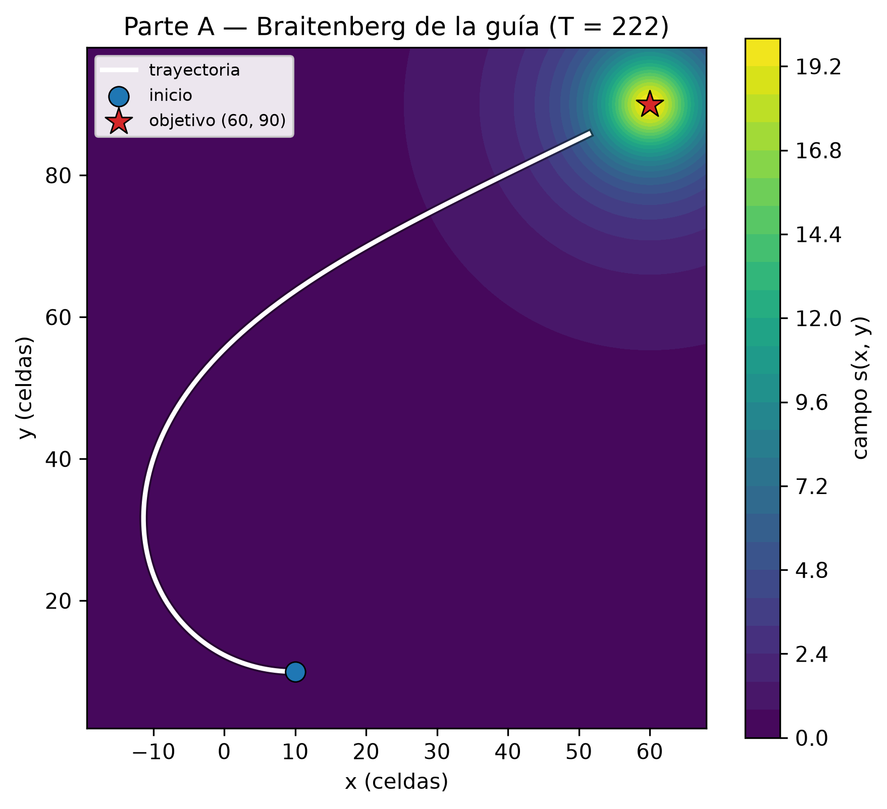
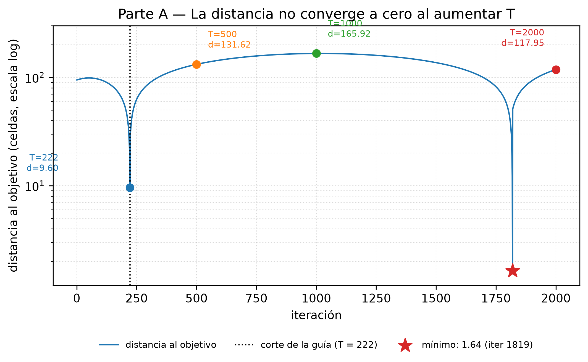
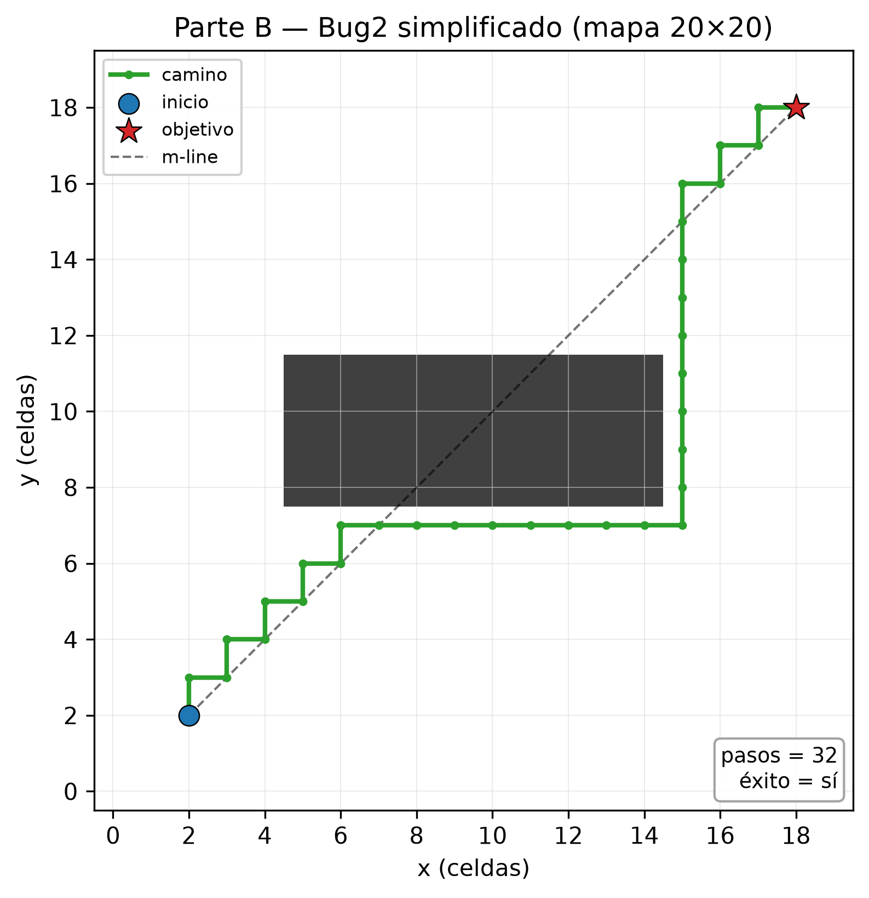
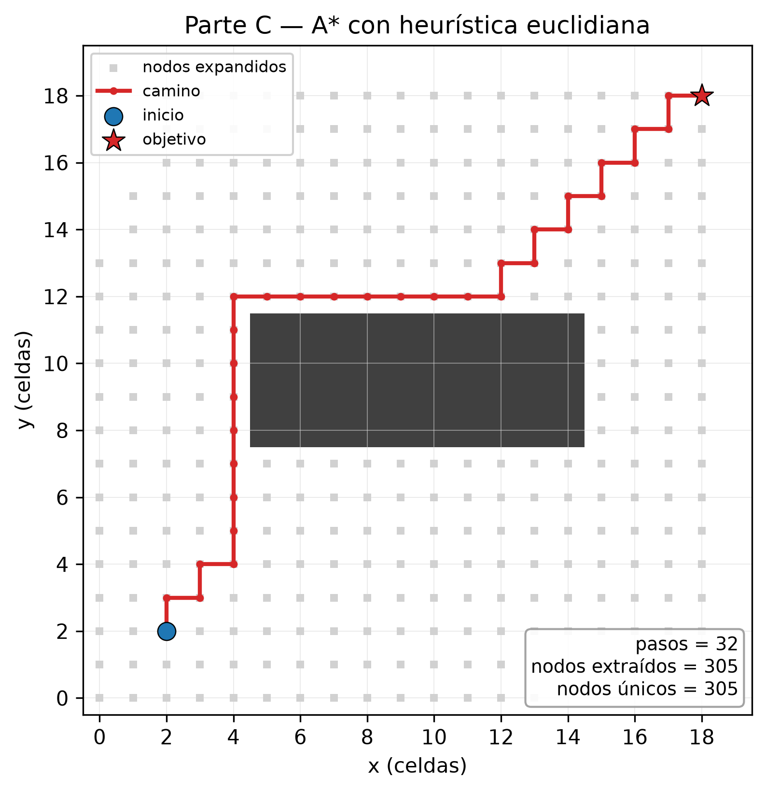
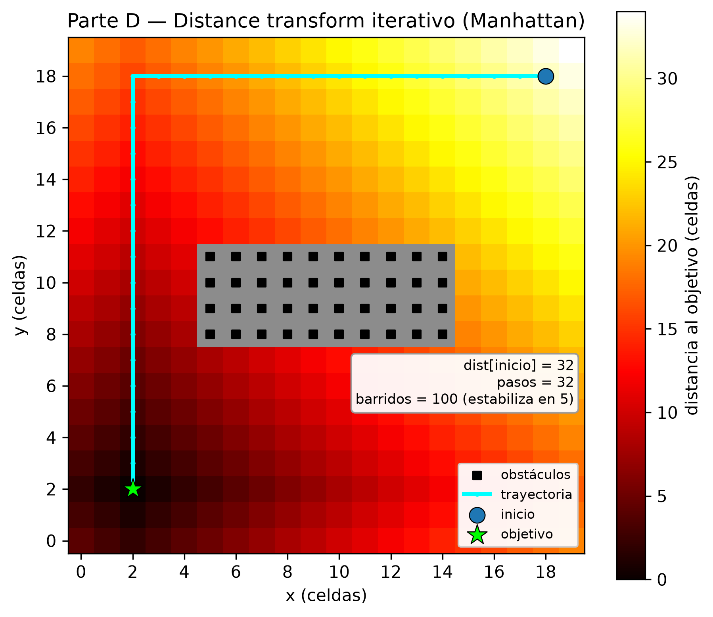

# Informe de laboratorio — Capítulo 5: Navegación de robots móviles

**Curso:** Robótica — Universidad Nacional de Colombia, sede Manizales  
**Semestre:** VIII — 2026-2  
**Guía:** *Guía de laboratorio de simulación, Capítulo 5 — Corke*  
**Actividades desarrolladas:** A, B, C y D (simulación en Python)  
**Integrantes:** [completar]  
**Fecha:** 20 de octubre de 2026

---

## 1. Resumen

Se implementaron y ejecutaron las cuatro actividades de simulación de la guía del Capítulo 5: el vehículo Braitenberg (parte A), el Bug2 simplificado (parte B), la planificación con A* (parte C) y el *distance transform* iterativo sobre un mapa de ocupación (parte D). Todas las simulaciones usan el mismo mapa de 20×20 celdas de la guía, con un obstáculo rectangular, y la misma convención de coordenadas. Se respondieron las doce preguntas de análisis con base en los resultados obtenidos y en el texto de Corke.

Los resultados principales son: el vehículo Braitenberg de la guía **no converge** al objetivo (distancia mínima ≈ 9.57 celdas y distancia final ≈ 131.62 celdas para T = 500); el Bug2 simplificado llega en **32 pasos**, que en este mapa coincide con la cota inferior de Manhattan y por tanto es óptimo, aunque el algoritmo no garantiza optimalidad en general; A* encuentra un camino de **32 pasos** expandiendo **305 nodos**; y el *distance transform* obtiene **32 pasos** con `dist[inicio] = 32`, estabilizándose en **5 barridos** aunque el código ejecuta 100.

---

## 2. Objetivos y alcance

### 2.1 Objetivos de la guía y su cumplimiento

| Objetivo de la guía | Dónde se cumple | Evidencia |
|---|---|---|
| Implementar estrategias de navegación reactiva | Parte A (Braitenberg) y parte B (Bug2) | Figuras A1, A2 y B1; respuestas A1–A3 y B1–B3 |
| Analizar algoritmos de evasión de obstáculos (Bug2) | Parte B | Figura B1, prueba con inicio/objetivo invertidos y respuestas B1–B3 |
| Implementar planificación de trayectorias con A* | Parte C | Figura C1 y respuestas C1–C3 |
| Aplicar planificación en mapas de ocupación | Parte D | Figura D1 y respuestas D1–D3 |
| Integrar navegación autónoma en ROS2 (Nav2) | **No incluida en esta entrega** | La instrucción del profesor para esta sesión cubre las partes A–D |

### 2.2 Alcance

Esta entrega cubre **las partes A, B, C y D** de la guía, que corresponden a los cuatro primeros objetivos. La parte E (ROS2/Nav2) no forma parte de la instrucción de esta sesión: requiere el stack de ROS2, `nav2_bringup` y un robot simulado, y se deja para una entrega posterior. Por eso todas las simulaciones de este informe son locales, con `numpy` y `matplotlib`, y no dependen de ROS2.

### 2.3 Estructura del laboratorio

```
Laboratorio/
├── README.md
├── requirements.txt
├── navegacion/
│   ├── mapas.py                 # mapa 20×20, convención grid[y,x], dibujo
│   ├── metricas.py              # longitud, distancias, CSV
│   ├── a_braitenberg.py         # parte A
│   ├── b_bug2.py                # parte B
│   ├── c_astar.py               # parte C
│   └── d_distance_transform.py  # parte D
├── experimentos/
│   ├── run_a.py … run_d.py      # un script por parte
│   └── run_all.py               # reproduce figuras + metricas.csv
├── figuras/                     # PNG 300 dpi + SVG
└── resultados/                  # metricas.csv
```

El código completo y ejecutable está en `Laboratorio/`. En este informe se incluyen las funciones centrales de cada parte y se referencian las figuras y los resultados numéricos.

---

## 3. Metodología y convenciones

- **Mapa:** `grid` de 20×20 celdas, con `grid[8:12, 5:15] = 1` (obstáculo rectangular de 4×10 celdas). Las celdas libres valen 0 y las ocupadas 1.
- **Coordenadas:** una celda se escribe como `(x, y)` y se indexa como `grid[y, x]`. En las figuras se usa `origin="lower"`, de modo que el eje y crece hacia arriba.
- **Conectividad:** las partes B, C y D usan 4 vecinos (arriba, abajo, izquierda, derecha) y costo unitario por arista. No se usan diagonales.
- **Inicio y objetivo:** las partes B y C usan `start = (2, 2)` y `goal = (18, 18)`. La parte D usa el problema invertido de la guía: `goal = (2, 2)` y `start = (18, 18)`. Para comparar D con B se ejecutó también D con `(2, 2) → (18, 18)`.
- **Distancias:** se reportan en celdas. La distancia de Manhattan entre `(2,2)` y `(18,18)` es `|18−2| + |18−2| = 32`; es la cota inferior para cualquier camino de 4 vecinos.
- **Reproducibilidad:** todas las figuras y la tabla `resultados/metricas.csv` se generan con `python experimentos/run_all.py` desde `Laboratorio/`. Los tiempos son mediciones locales e indicativas.

### 3.1 Ajustes mínimos respecto al código de la guía

Se conservó la lógica de la guía. Los cambios fueron de instrumentación y robustez, no de algoritmo:

1. Se eliminaron los `print` dentro de los bucles (la guía imprime cada iteración).
2. En `is_free` se añadió la comprobación de límites del mapa, para que el seguidor de borde no consulte índices fuera de la matriz.
3. En A* se añadió un contador de nodos extraídos/encolados y la lista de nodos expandidos; también se corrigió la comparación de `x` con el ancho (`shape[1]`) y de `y` con el alto (`shape[0]`); la guía usa `shape[0]` para `x` y `shape[1]` para `y`, lo que solo funciona en mapas cuadrados.
4. En el *distance transform* se registra el barrido en que el mapa se estabiliza, pero se siguen ejecutando los 100 barridos de la guía.
5. Se cambió el backend de Matplotlib a `Agg` para guardar figuras sin ventana.

**Importante:** la ley de control de la parte A es la de la guía, `v = −Kv·(sL + sR)`, no la del libro, `v = 2 − sR − sL`. Esa diferencia es el objeto de análisis de A2 y A3. Del mismo modo, el Bug2 de la parte B es la versión simplificada de la guía, sin m-line ni condición de salida; el informe discute esa limitación.

---

## 4. Parte A — Navegación reactiva con un vehículo Braitenberg

### 4.1 Objetivo

Implementar un robot que se dirija hacia un objetivo usando únicamente dos sensores laterales y una ley de control directa, sin mapa ni planificación.

### 4.2 Implementación

El campo escalar tiene su máximo en `(60, 90)`:

```
s(x, y) = 1000 / ((x − 60)² + (y − 90)² + 50)
```

Los dos sensores están separados lateralmente una distancia `d = 2` respecto al eje del robot. La ley de control de la guía es:

```
v     = −Kv · (sL + sR)
ω     =  Ks · (sR − sL)
```

con `Ks = 17`, `Kv = 14`, `dt = 0.1`, estado inicial `(10, 10, 0°)` y `T = 222` iteraciones. La cinemática es la del robot diferencial simplificado:

```
x     ← x + v·cos(θ)·dt
y     ← y + v·sin(θ)·dt
θ     ← θ + ω·dt
```

Código central (el completo está en `navegacion/a_braitenberg.py`):

```python
def sensorfield(x, y):
    xc, yc = (60.0, 90.0)
    return 1000.0 / ((x - xc) ** 2 + (y - yc) ** 2 + 50.0)

d = 2.0
for i in range(T):
    sL = sensorfield(x - d * np.sin(theta), y + d * np.cos(theta))
    sR = sensorfield(x + d * np.sin(theta), y - d * np.cos(theta))

    v = -Kv * (sL + sR)
    omega = Ks * (sR - sL)

    x += v * np.cos(theta) * dt
    y += v * np.sin(theta) * dt
    theta += omega * dt
```

### 4.3 Resultados



**Figura A1.** El color representa el campo `s(x, y)` y la línea blanca la trayectoria. El robot parte de `(10, 10)`, se desplaza inicialmente hacia la izquierda (alejándose en x del objetivo), describe un amplio arco y termina en `(51.36, 85.82)`, a 9.60 celdas del objetivo.



**Figura A2.** La distancia al objetivo a lo largo de la trayectoria completa. Los puntos marcan el corte de cada `T` sobre la misma curva: con `T = 222` el robot queda a 9.60 celdas; con `T = 500` la distancia final es 131.62; con `T = 1000`, 165.92; y con `T = 2000`, 117.95. El mínimo global es 1.64 en la iteración 1819, pero el robot no se detiene y vuelve a alejarse.

| T | Distancia mínima (celdas) | Iteración del mínimo | Distancia final (celdas) | Posición final (x, y) |
|---:|---:|---:|---:|---:|
| 222 | 9.596 | 222 | 9.596 | (51.36, 85.82) |
| 500 | 9.570 | 223 | 131.620 | (171.48, 159.97) |
| 1000 | 9.570 | 223 | 165.918 | (169.71, 214.47) |
| 2000 | 1.642 | 1819 | 117.951 | (25.35, −22.75) |

### 4.4 Respuestas a las preguntas de la Parte A

#### A1. ¿Cómo influye la diferencia entre sensores en la dirección del robot?

La diferencia `sR − sL` es la estimación discreta de la componente lateral del gradiente del campo. La ley `ω = Ks·(sR − sL)` hace que el robot gire hacia el sensor que mide más campo:

- Si `sR > sL`, entonces `ω > 0` y el robot gira en sentido antihorario (hacia la izquierda).
- Si `sL > sR`, entonces `ω < 0` y el robot gira en sentido horario (hacia la derecha).
- Si `sL = sR`, el robot va recto.

La magnitud de `ω` es proporcional a la diferencia y a `Ks`. En la corrida de la guía, al inicio `sL ≈ 0.116` y `sR ≈ 0.108`, porque el sensor izquierdo está más cerca del objetivo en `y`; por eso `ω ≈ −0.14 rad/s` y el robot gira lentamente en sentido horario. La diferencia es pequeña mientras el robot está lejos, así que el giro es suave; cerca del objetivo la diferencia también se hace pequeña y el robot deja de corregir el rumbo. La Figura A1 muestra el resultado: el robot no apunta directamente al objetivo, sino que describe un arco.

#### A2. ¿Qué ocurre cuando el robot se aproxima al objetivo?

Ocurren dos cosas opuestas. Por un lado, el campo crece como `1/r²` y la **velocidad lineal crece en magnitud**: `v = −Kv·(sL + sR)` no tiene saturación ni término de frenado. Por otro, la diferencia entre sensores se reduce porque ambos sensores ven casi el mismo campo, de modo que `ω → 0` y el robot deja de girar.

El resultado es un **sobrepaso**: el robot llega cerca del objetivo con una velocidad grande y no tiene forma de detenerse. En la corrida de 222 pasos, la distancia mínima es 9.60 celdas; al continuar un paso más, la posición salta de `(51.36, 85.82)` a `(68.62, 94.17)`, un desplazamiento de ≈19.2 celdas en un solo paso, porque `|v| ≈ 191.7` y `dt = 0.1`. La distancia al objetivo en ese paso es 9.57: el robot pasó al otro lado, no por el objetivo. Después el campo vuelve a ser pequeño, la velocidad baja y el robot se aleja.

La ley del libro es distinta: en su modelo, `v = 2 − sR − sL` tiende a cero cuando `sR = sL = 1` en el objetivo, de modo que el robot frena y converge asintóticamente. La ley de la guía, con signo negativo y sin frenado, no tiene ese comportamiento. Esa es la explicación de por qué la distancia de la Figura A2 no baja a cero.

#### A3. ¿Qué limitaciones presenta este enfoque? ¿Qué pasa si se aumenta la cantidad de iteraciones?

Las limitaciones principales son:

1. **No hay condición de parada.** El robot nunca “sabe” que llegó; sigue moviéndose mientras el campo sea distinto de cero.
2. **No hay saturación de velocidad.** Cerca del objetivo, `|v|` crece y el paso de integración se vuelve muy grande; el robot sobrepasa el objetivo.
3. **No evita obstáculos.** El campo es global y conocido; un obstáculo físico bloquearía al robot, como señala Corke. No hay sensores de proximidad ni comportamiento de evasión.
4. **No tiene mapa ni memoria.** Es puramente reactivo; no puede planificar ni recordar por dónde pasó.
5. **Es sensible a los parámetros y al paso `dt`.** Cambiar `Ks`, `Kv` o `dt` cambia la trayectoria; un `dt` grande puede hacer que el robot salte sobre el objetivo.
6. **Puede quedar atrapado en máximos locales** si el campo tiene varias fuentes o valles.

Al aumentar las iteraciones **no se converge**: con `T = 500` la distancia final es 131.62; con `T = 1000`, 165.92; con `T = 2000`, 117.95. La trayectoria es una órbita que se aleja y vuelve a pasar cerca del objetivo por casualidad (mínimo 1.64 en la iteración 1819), pero no se detiene. Aumentar `T` solo alarga la órbita; no corrige la ley de control. Para que converja habría que cambiar la ley (por ejemplo, la del libro, `v = 2 − sR − sL`) o añadir una condición de parada y una saturación de velocidad.

---

## 5. Parte B — Navegación con Bug2

### 5.1 Objetivo

Implementar un algoritmo de navegación con evasión de obstáculos sin mapa global: avanzar hacia el objetivo y, cuando se detecte un obstáculo, seguirlo por el borde hasta poder retomar el avance.

### 5.2 Implementación

El código de la guía es un Bug2 simplificado. En cada iteración:

1. Calcula la dirección al objetivo.
2. Avanza por el eje de mayor diferencia (sin diagonales).
3. Si la celda siguiente está ocupada, prueba los vecinos en el orden derecha, arriba, izquierda, abajo y se mueve al primero libre.
4. Registra la posición y termina si está a menos de 1 celda del objetivo.

No se calcula la m-line ni la condición de salida del Bug2 completo; esa es una diferencia importante que se discute en B2.

Código central (el completo está en `navegacion/b_bug2.py`):

```python
def bug2(grid, start, goal, max_iter=500):
    pos = np.array(start, dtype=int)
    goal_arr = np.array(goal, dtype=int)
    path = [pos.copy()]
    exito = False

    for iteraciones in range(1, max_iter + 1):
        direction = goal_arr - pos

        if abs(direction[0]) > abs(direction[1]):
            step = np.array([int(np.sign(direction[0])), 0], dtype=int)
        else:
            step = np.array([0, int(np.sign(direction[1]))], dtype=int)

        next_pos = pos + step

        if is_free(grid, next_pos):
            pos = next_pos
        else:
            for move in (np.array([1, 0]), np.array([0, 1]),
                         np.array([-1, 0]), np.array([0, -1])):
                if is_free(grid, pos + move):
                    pos = pos + move
                    break

        path.append(pos.copy())
        if np.linalg.norm(pos - goal_arr) < 1:
            exito = True
            break

    return np.asarray(path), exito, iteraciones
```

### 5.3 Resultados



**Figura B1.** El obstáculo es la región gris; la línea negra discontinua es la m-line (la recta ideal entre inicio y objetivo), que atraviesa el obstáculo. El camino verde lo rodea por abajo y por la derecha, y llega al objetivo en 32 pasos. La m-line se dibuja solo como referencia: el código de la guía no la usa.

| Métrica | Valor |
|---|---:|
| Longitud del camino | 32 pasos |
| Longitud euclidiana | 32.0 celdas |
| ¿Llegó al objetivo? | Sí |
| Iteraciones | 32 |
| Cota inferior de Manhattan | 32 |
| Prueba con inicio/objetivo invertidos | No llega; 500 iteraciones; 13 celdas únicas; ciclo entre (12,12) y (13,12) |

### 5.4 Respuestas a las preguntas de la Parte B

#### B1. ¿El camino obtenido es óptimo? Justifique.

**En este mapa, sí.** Cualquier camino de 4 vecinos desde `(2,2)` hasta `(18,18)` necesita al menos `|18−2| + |18−2| = 32` pasos, porque cada paso cambia una sola coordenada en una unidad. El camino de la Figura B1 tiene exactamente 32 pasos, así que alcanza la cota inferior y es óptimo. El obstáculo no obliga a un rodeo adicional: el camino pasa por `y = 7`, justo debajo del obstáculo, y sube por `x = 15`, justo a la derecha, sin salirse de la escalera monótona.

**Pero el algoritmo no garantiza optimalidad en general.** Bug2 es un algoritmo local: sigue el borde del obstáculo y no tiene una visión global del mapa. En el ejemplo de la casa del libro, el Bug2 completo recorre 1307 puntos, mientras que el *distance transform* encuentra un camino de 338 pasos, casi cuatro veces más corto. La optimalidad de este mapa es una coincidencia favorable de la geometría, no una propiedad del algoritmo. Además, la versión de la guía es más débil que el Bug2 completo: no usa la m-line ni la condición de salida, como se ve en B2.

#### B2. ¿Qué sucede en entornos complejos?

El Bug2 simplificado puede tomar caminos muy largos, oscilar o quedar en un ciclo. La razón es que el seguimiento de borde es una regla fija (probar derecha, arriba, izquierda, abajo) y no verifica si el robot está avanzando hacia el objetivo. En obstáculos cóncavos, el robot puede repetir un par de celdas indefinidamente.

Una prueba con el mismo código y el mismo mapa, pero intercambiando inicio y objetivo (`(18,18) → (2,2)`), lo muestra: el robot pasa por 13 celdas distintas, llega a `(12,12)` y queda ciclando entre `(12,12)` y `(13,12)` durante las 500 iteraciones, sin llegar. En `(12,12)`, la diferencia en x y en y con el objetivo es la misma (`−10, −10`), así que el código intenta bajar a `(12,11)`, que es obstáculo; el fallback prueba la derecha, `(13,12)`, que está libre. Desde `(13,12)` el paso dominante es a la izquierda, de vuelta a `(12,12)`, y allí vuelve a intentar bajar: el ciclo se repite. Es consecuencia directa de la regla de desempate y de no tener una condición de salida.

El Bug2 completo del libro evita ese problema porque, al encontrar un obstáculo, sigue el borde hasta volver a la m-line en un punto **más cercano al objetivo** que el punto donde la dejó. Esa condición le permite abandonar el borde y retomar el avance. Aun así, el Bug2 completo sigue siendo subóptimo: en la casa recorre 1307 pasos frente a 338 del *distance transform*. La limitación de fondo es la falta de mapa global: sin “la foto completa”, el robot toma decisiones localmente correctas pero globalmente largas.

#### B3. Compare con el enfoque reactivo de la Parte A.

| Aspecto | A — Braitenberg | B — Bug2 simplificado |
|---|---|---|
| ¿Usa mapa global? | No | No |
| ¿Tiene memoria/estado? | No | Sí: registra el camino y detecta obstáculos |
| ¿Detecta obstáculos? | No | Sí: consulta las celdas vecinas |
| ¿Llega al objetivo? | No en la ley de la guía (mínimo 9.57) | Sí, en 32 pasos en este mapa |
| Trayectoria | Continua, suave, orbital | Discreta, en escalera |
| Optimalidad | No | En este mapa sí; en general no |
| Robustez en entornos complejos | Se bloquea con un obstáculo | Puede ciclar en la versión simplificada |

La diferencia conceptual es el **estado**: el Braitenberg conecta sensores y motores directamente, sin memoria; el Bug2 añade una máquina de estados (avanzar / seguir borde) y recuerda el camino. Esa memoria le permite resolver obstáculos que el Braitenberg no puede evitar, pero sigue siendo un método reactivo, sin planificación global. El Braitenberg es más suave y simple; el Bug2 es más robusto frente a obstáculos, a costa de un camino discreto y potencialmente largo.

---

## 6. Parte C — Planificación con A*

### 6.1 Objetivo

Representar el entorno como un grafo (grid) e implementar A* para calcular una ruta óptima desde el inicio hasta el objetivo, usando una función heurística.

### 6.2 Implementación

El grid se representa con la misma matriz de 20×20. A* usa una cola de prioridad con `f(n) = g(n) + h(n)`, donde `g(n)` es el costo desde el inicio y `h(n)` es la distancia euclidiana al objetivo:

```
h(n) = ||n − goal||₂
```

La guía usa 4 vecinos y costo 1 por arista. El código mantiene un diccionario `cost` con el mejor costo conocido y un diccionario `came_from` para reconstruir el camino. No usa un conjunto cerrado; si encuentra un costo mejor, vuelve a encolar el nodo.

Código central (el completo está en `navegacion/c_astar.py`):

```python
def heuristic(a, b):
    return float(np.linalg.norm(np.asarray(a, float) - np.asarray(b, float)))

def astar(grid, start, goal):
    start, goal = tuple(start), tuple(goal)
    open_list = []
    heapq.heappush(open_list, (0.0, start))
    came_from = {}
    cost = {start: 0}
    expandidos = []
    encolados = 1

    while open_list:
        _, current = heapq.heappop(open_list)
        expandidos.append(current)

        if current == goal:
            break

        for dx, dy in ((-1, 0), (1, 0), (0, -1), (0, 1)):
            neighbor = (current[0] + dx, current[1] + dy)

            if (0 <= neighbor[0] < grid.shape[1] and
                0 <= neighbor[1] < grid.shape[0] and
                grid[neighbor[1], neighbor[0]] == 0):

                new_cost = cost[current] + 1

                if neighbor not in cost or new_cost < cost[neighbor]:
                    cost[neighbor] = new_cost
                    priority = new_cost + heuristic(neighbor, goal)
                    heapq.heappush(open_list, (priority, neighbor))
                    came_from[neighbor] = current
                    encolados += 1

    if goal != start and goal not in came_from:
        return [], len(expandidos), encolados, expandidos, None

    path = []
    node = goal
    while node != start:
        path.append(node)
        node = came_from[node]
    path.append(start)
    path.reverse()
    return path, len(expandidos), encolados, expandidos, cost.get(goal)
```

### 6.3 Resultados



**Figura C1.** Los cuadros grises son los nodos extraídos de la cola (305 en total); la línea roja es el camino de 32 pasos. A* sube por `x = 4` hasta `y = 12`, cruza por encima del obstáculo y luego avanza en escalera hasta `(18,18)`. Es una ruta distinta de la de Bug2 (que pasa por debajo y sube por `x = 15`), pero también mide 32 pasos.

| Métrica | Valor |
|---|---:|
| Longitud del camino | 32 pasos |
| Costo `g(objetivo)` | 32 aristas |
| Nodos extraídos de la cola | 305 |
| Nodos únicos extraídos | 305 |
| Nodos encolados | 347 |
| ¿Llegó al objetivo? | Sí |
| Tiempo de cómputo (indicativo) | ≈ 1.2 ms |

### 6.4 Respuestas a las preguntas de la Parte C

#### C1. ¿Qué diferencia hay entre BFS, UCS y A*?

| Algoritmo | Criterio de expansión | ¿Qué garantiza? | Comentario |
|---|---|---|---|
| **BFS** (*breadth-first search*) | Cola FIFO: expande por número de aristas | Camino con el menor número de aristas, si todas cuestan lo mismo | No usa costos; en un grid con costo unitario coincide con UCS, pero explora muchos nodos |
| **UCS** (*uniform-cost search*) | Cola de prioridad por `g(n)`, el costo desde el inicio | Camino de costo mínimo con costos no negativos | Explora en todas las direcciones, como una onda; no usa información del objetivo |
| **A\*** | Cola de prioridad por `f(n) = g(n) + h(n)` | Camino de costo mínimo si `h` es admisible | Usa la heurística para dirigir la búsqueda y expandir menos nodos |

Las relaciones son: BFS es UCS cuando todas las aristas cuestan 1; UCS es A* cuando `h(n) = 0`. A* es el más informado de los tres, pero su optimalidad depende de la heurística. En el ejemplo de grafos del libro, UCS explora 19 vértices y A* explora 12 para el mismo camino óptimo de 1659; la diferencia es el efecto de `h`.

#### C2. ¿Cuál es el papel de la heurística?

La heurística `h(n)` es una **estimación del costo que falta** desde `n` hasta el objetivo. Su papel es sesgar la búsqueda hacia las zonas prometedoras: si `h` es informativa, A* expande menos nodos que UCS y encuentra el mismo camino óptimo.

Para que A* garantice optimalidad, `h` debe ser **admisible**: `h(n) ≤ h*(n)`, donde `h*(n)` es el costo real mínimo de `n` al objetivo. La distancia euclidiana es admisible en un grid de 4 vecinos con costo unitario porque la distancia en línea recta es una cota inferior de cualquier camino (que solo puede moverse en horizontal y vertical). También es **consistente**: `h(n) ≤ c(n,n') + h(n')`, pues un paso cambia la posición en una unidad y la distancia euclidiana cambia como máximo en una unidad.

En el código de la guía, `h` es euclidiana. El camino obtenido cuesta 32, que es la cota inferior de Manhattan; por tanto, en este mapa el resultado es óptimo. Sin embargo, la heurística euclidiana es **poco informativa** en 4-conectividad: para un desplazamiento diagonal, la distancia euclidiana es menor que la Manhattan, y muchos nodos tienen valores de `f` parecidos. Por eso A* expande 305 de las 360 celdas libres (≈85 %). Una heurística Manhattan, más ajustada a la métrica de 4 vecinos, seguiría siendo admisible y reduciría las expansiones. La heurística `h = 0` también es admisible, pero convierte A* en UCS y explora aún más.

#### C3. ¿Qué ocurre si la heurística no es adecuada?

Depende del tipo de inadequación:

- **Si sobreestima (`h(n) > h*(n)`, no admisible):** A* puede descartar un camino mejor y devolver un camino **subóptimo**. La garantía de optimalidad se pierde, porque el objetivo puede extraerse de la cola antes de que se explore una ruta más barata.
- **Si subestima mucho (por ejemplo, `h = 0`):** A* sigue siendo óptimo, pero se degrada a UCS y expande muchos más nodos. La búsqueda se vuelve más lenta.
- **Si es inconsistente:** puede violar `h(n) ≤ c(n,n') + h(n')`; con un conjunto cerrado que no reabre nodos, un nodo podría quedar cerrado con un costo que luego mejora. El código de la guía no usa conjunto cerrado, así que puede reencolar y corregir, pero el primer objetivo extraído solo está garantizado si `h` es admisible.
- **Si es exactamente `h*(n)`:** A* expande solo los nodos del camino óptimo; es el caso ideal, pero requiere conocer el costo real, que es justamente lo que se quiere calcular.

En resumen: la heurística debe ser admisible para no perder optimalidad, y lo más ajustada posible (sin sobreestimar) para reducir el número de expansiones. La heurística euclidiana de la guía es admisible y correcta, pero no la más eficiente para este grid de 4 vecinos.

---

## 7. Parte D — Mapas de ocupación y distance transform

### 7.1 Objetivo

Generar una trayectoria óptima sobre un mapa de ocupación usando un *distance transform*: calcular para cada celda libre la distancia al objetivo y obtener el camino bajando por ese mapa de distancias.

### 7.2 Implementación

El código de la guía usa 4 vecinos y costo unitario, así que calcula una **distance transform Manhattan (L1)**, no la euclidiana que usa el toolbox de Corke por defecto. La inicialización es:

```
dist[goal] = 0
dist[otras celdas] = ∞
```

y la actualización iterativa es:

```
dist[y, x] = min(dist[y, x], 1 + min(dist[vecinos]))
```

para cada celda libre, barrierendo el mapa de izquierda a derecha y de abajo hacia arriba. Los obstáculos quedan en `∞`. Después, el camino se extrae desde `start` eligiendo repetidamente el vecino con menor `dist`, hasta llegar a `goal`.

Código central (el completo está en `navegacion/d_distance_transform.py`):

```python
def distance_transform(grid, goal, n_iter=100):
    alto, ancho = grid.shape
    dist = np.full((alto, ancho), np.inf, dtype=float)
    gx, gy = int(goal[0]), int(goal[1])
    dist[gy, gx] = 0.0
    barridos_estabilizacion = None

    for it in range(n_iter):
        cambio = False
        for x in range(ancho):
            for y in range(alto):
                if grid[y, x] != 0:
                    continue

                mejor = dist[y, x]
                for dx, dy in ((-1, 0), (1, 0), (0, -1), (0, 1)):
                    nx, ny = x + dx, y + dy
                    if 0 <= nx < ancho and 0 <= ny < alto:
                        candidato = dist[ny, nx] + 1.0
                        if candidato < mejor:
                            mejor = candidato

                if mejor < dist[y, x]:
                    dist[y, x] = mejor
                    cambio = True

        if not cambio and barridos_estabilizacion is None:
            barridos_estabilizacion = it + 1

    if barridos_estabilizacion is None:
        barridos_estabilizacion = n_iter

    return dist, barridos_estabilizacion


def extraer_camino(dist, start, goal, max_iter=200):
    pos = tuple(start)
    goal = tuple(goal)
    path = [pos]
    alto, ancho = dist.shape

    for _ in range(max_iter):
        if pos == goal:
            break

        x, y = pos
        mejor = None
        for dx, dy in ((-1, 0), (1, 0), (0, -1), (0, 1)):
            nx, ny = x + dx, y + dy
            if 0 <= nx < ancho and 0 <= ny < alto:
                valor = dist[ny, nx]
                if mejor is None or valor < mejor[1]:
                    mejor = ((nx, ny), valor)

        if mejor is None or not np.isfinite(mejor[1]):
            break

        pos = mejor[0]
        path.append(pos)

    return np.asarray(path, dtype=int)
```

### 7.3 Resultados



**Figura D1.** El mapa de calor muestra la distancia Manhattan al objetivo `(2,2)`; los obstáculos se pintan en gris con cuadros negros. La trayectoria cian sale de `(18,18)`, recorre el borde superior hasta `(2,18)` y baja por el borde izquierdo hasta `(2,2)`. La distancia en el inicio es 32, igual que la longitud del camino.

| Métrica | Valor |
|---|---:|
| Longitud del camino | 32 pasos |
| `dist[start]` | 32 celdas |
| Barridos ejecutados | 100 |
| Barrido de estabilización | 5 (4 con cambios + 1 de verificación) |
| Celdas libres | 360 |
| Obstáculos | 40 |
| Tiempo de cómputo (indicativo) | ≈ 31 ms |
| Comparación con Bug2, mismo problema `(2,2) → (18,18)` | DT 32 pasos; Bug2 32 pasos |

### 7.4 Respuestas a las preguntas de la Parte D

#### D1. ¿Por qué este método garantiza optimalidad?

El *distance transform* de la guía calcula, para la métrica Manhattan (4 vecinos, costo 1), la **función de costo restante** `D(c)` para cada celda libre `c`. En el punto fijo de la iteración se cumple la ecuación de Bellman:

```
D(meta) = 0
D(c)    = 1 + min_{n ∈ N(c)} D(n)      para c ≠ meta
```

donde `N(c)` son los vecinos de `c`. La interpretación es directa: desde `c`, el mejor movimiento es ir al vecino con menor distancia y pagar 1. Si se sigue esa regla, cada paso reduce `D` exactamente en 1, así que se llega a la meta en `D(c)` pasos.

Para ver que es óptimo, sea `L` la longitud de cualquier camino desde `c` hasta la meta. Por inducción en los pasos, `D(c) ≤ L`: en la meta `D = 0`; y si desde `c` se va a un vecino `n`, `D(c) = 1 + min_{n'} D(n') ≤ 1 + D(n) ≤ 1 + (L − 1) = L`. Además, el camino que baja por el vecino de menor `D` alcanza esa cota, porque cada paso reduce `D` en 1. Por tanto, `D(c)` es la longitud mínima y el camino extraído es óptimo.

En el mapa de la guía, `D(start) = 32` y el camino tiene 32 pasos. La cota inferior de Manhattan también es 32, así que el resultado es óptimo por dos vías: la ecuación de Bellman y la cota geométrica.

Una precisión importante: la optimalidad es una propiedad del **punto fijo** y de la **métrica modelada**. La guía titula esta sección “DISTANCE TRANSFORM (NO ÓPTIMO)”; esa etiqueta se explica por dos limitaciones de la implementación: (i) usa 4 vecinos y costo 1, así que optimiza la distancia Manhattan, no la euclidiana; (ii) ejecuta 100 barridos fijos y no verifica la convergencia. En el mapa 20×20 el punto fijo se alcanza en 5 barridos y el camino de 32 pasos es óptimo **en la métrica Manhattan**; para movimiento continuo con diagonales, la ruta no es la euclidiana más corta. La optimalidad de la ecuación de Bellman es válida para la métrica y el grafo que se modelan; el número fijo de barridos es una limitación aparte.

#### D2. ¿Cuál es su costo computacional?

Sea `N` el lado de un mapa cuadrado de `N×N` celdas (aquí `N = 20`).

- **Cada barrido** recorre las `N²` celdas y, para cada celda libre, mira 4 vecinos: `O(N²)` operaciones.
- **El número de barridos** depende de cuánto tarde la información en propagarse desde la meta hasta la celda más lejana. En un mapa abierto es del orden de `N`; en un laberinto puede ser del orden de `N²`. El libro señala que el número de iteraciones es **al menos** `O(N)`, lo que da un costo típico de `O(N³)`; en el peor caso (laberinto) se puede llegar a `O(N⁴)`.
- **La memoria** es `O(N²)`, porque se guarda un valor de distancia por celda.

Para el mapa de 20×20: 100 barridos × 400 celdas × 4 vecinos ≈ `1.6×10^5` actualizaciones, un costo trivial (≈31 ms en este equipo, incluyendo la extracción del camino). El mapa se estabiliza en 5 barridos, así que los otros 95 no cambian nada. Para la casa del libro (397×596), el método necesitó **571 barridos** y quedaron 9925 celdas inalcanzables; el límite fijo de 100 barridos de la guía no alcanzaría. Esa es la principal limitación de costo del código de la guía: el número de barridos debería adaptarse al tamaño y a la complejidad del mapa, o detectar la convergencia y detenerse.

#### D3. Compare con el algoritmo Bug2.

| Criterio | Bug2 (simplificado de la guía) | Distance transform |
|---|---|---|
| ¿Usa mapa global? | No: solo sensores locales | Sí: recorre todo el mapa |
| ¿Cuándo calcula? | Online, mientras se mueve | Precomputa el mapa de distancias |
| Optimalidad | No garantizada; en este mapa dio 32 por la geometría | Sí, en la métrica Manhattan, al alcanzar el punto fijo |
| Resultado en el mapa 20×20 | 32 pasos | 32 pasos |
| Resultado en la casa del libro | 1307 pasos | 338 pasos |
| Robustez | Puede ciclar en la versión simplificada; el Bug2 completo es completo pero subóptimo | Completo si el objetivo es alcanzable; no cicla |
| Costo | Barato por paso, pero puede dar rodeos largos | Costoso por adelantado (`O(N³)` típico), pero óptimo |

En el mapa de 20×20 ambos métodos dan 32 pasos, pero por razones distintas: Bug2 aprovecha que la escalera monótona puede rodear el obstáculo sin pasos extra; el *distance transform* calcula la distancia mínima para todas las celdas y luego baja por el gradiente. Los caminos son distintos (Bug2 pasa por debajo del obstáculo; el DT por el borde superior e izquierdo), pero ambos tienen la misma longitud óptima.

La diferencia se vuelve clara en la casa: el DT encuentra 338 pasos y el Bug2 completo 1307, casi cuatro veces más. El precio es el cómputo global: el DT necesita el mapa completo y 571 barridos. Bug2 solo necesita sensores locales y avanza paso a paso, pero no tiene “la foto completa” y por eso se conforma con rutas localmente razonables. En la versión simplificada de la guía, además, el Bug2 puede quedar en un ciclo si el desempate lo lleva a un callejón; el DT no tiene ese problema porque el mapa de distancias es global.

---

## 8. Síntesis comparativa

| Parte | Método | ¿Mapa global? | ¿Memoria? | Optimalidad | Resultado en el mapa 20×20 | Limitación principal |
|---|---|---|---|---|---|---|
| **A** | Braitenberg | No | No | No | `d_min = 9.57`; no llega; `d_final = 131.62` con T = 500 | Sin frenado, sin obstáculos, sin parada |
| **B** | Bug2 simplificado | No | Sí (camino/estado) | En este mapa 32 = óptimo; no garantizada | 32 pasos | Ciclos en el caso invertido; sin m-line |
| **C** | A* | Sí | Sí (cola y costos) | Sí, con `h` admisible | 32 pasos; 305 expansiones | Requiere mapa y heurística |
| **D** | Distance transform | Sí | Sí (mapa de distancias) | Sí (Bellman, Manhattan) | 32 pasos; `dist[start] = 32` | Cómputo previo; 100 barridos fijos |

La progresión A → B → C → D muestra el compromiso central de la navegación:

- **A** usa solo información instantánea de los sensores; es simple y suave, pero no tiene memoria, no evita obstáculos y no se detiene.
- **B** añade estado y una regla de evasión; resuelve obstáculos, pero sigue siendo local y puede dar rodeos o ciclar.
- **C** y **D** usan un mapa global; garantizan optimalidad, pero pagan con información y cómputo por adelantado. A* busca solo lo necesario; el DT calcula la solución para todas las celdas.

---

## 9. Conclusiones

1. **La ley de Braitenberg de la guía no converge.** La combinación de velocidad negativa, ausencia de saturación y falta de condición de parada hace que el robot pase cerca del objetivo y se aleje. Con `T = 222` queda a 9.60 celdas; con `T = 500`, a 131.62; con `T = 2000`, a 117.95, aunque en la iteración 1819 pasa a 1.64. Aumentar las iteraciones no corrige el problema. La ley del libro, `v = 2 − sR − sL`, sí frena en el objetivo porque `v → 0` cuando `sR = sL = 1`.

2. **El Bug2 simplificado es óptimo en este mapa, pero no en general.** El camino de 32 pasos alcanza la cota inferior de Manhattan y, por tanto, es óptimo en el mapa 20×20. Sin embargo, el algoritmo no tiene garantía de optimalidad y la versión de la guía puede ciclar: con inicio y objetivo invertidos, queda entre `(12,12)` y `(13,12)` durante 500 iteraciones. El Bug2 completo del libro evita el ciclo con la m-line, pero sigue siendo subóptimo (1307 pasos en la casa frente a 338 del DT).

3. **A* y el distance transform coinciden en la longitud óptima, pero no en el camino.** Ambos encuentran 32 pasos en el mapa 20×20. A* expande 305 nodos y devuelve una ruta por arriba del obstáculo; el DT calcula el mapa completo y devuelve una ruta por el borde superior e izquierdo. La diferencia es el tipo de cómputo: A* busca solo lo necesario; el DT precomputa la solución para todas las celdas.

4. **La heurística euclidiana es admisible pero poco informativa en 4-conectividad.** A* expande el 85 % de las celdas libres. Una heurística Manhattan sería más ajustada a la métrica del grid y reduciría las expansiones, sin perder optimalidad. Si la heurística sobreestima, A* puede devolver un camino subóptimo; si es cero, se degrada a UCS.

5. **El límite fijo de 100 barridos del DT no escala.** En el mapa 20×20 el mapa se estabiliza en 5 barridos, pero la casa del libro necesita 571. El código de la guía debería detectar la convergencia y detenerse, o adaptar el número de barridos al tamaño del mapa.

6. **La parte E (ROS2/Nav2) queda fuera de esta entrega.** Las cuatro actividades A–D cubren los objetivos de navegación reactiva, Bug2, A* y mapas de ocupación. La integración en ROS2 requiere el stack de Nav2 y un robot simulado, y se deja para una entrega posterior.

---

## 10. Referencias

- Corke, P. (2023). *Robotics, Vision and Control: Fundamental Algorithms in Python* (3rd ed.). Springer. Capítulo 5: §5.1.1 (Braitenberg), §5.1.2 (Bug2), §5.3 (A*), §5.4.1 (distance transform).
- Guía de laboratorio de simulación, Capítulo 5 — Corke. Universidad Nacional de Colombia, sede Manizales, 2026.
- Corke, P. *RVC3-python*: notebook `notebooks/chap5.ipynb` y modelo `RVC3/models/braitenberg.py`.
- Resultados locales: `Laboratorio/resultados/metricas.csv`; figuras en `Laboratorio/figuras/`.

---

## Anexo — Cómo reproducir

Desde `Laboratorio/`:

```bash
# Con el entorno del curso
source ~/venvs/robotica/bin/activate

# Todas las partes: figuras + resultados/metricas.csv
python experimentos/run_all.py

# Una parte concreta
python experimentos/run_a.py
python experimentos/run_b.py
python experimentos/run_c.py
python experimentos/run_d.py
```

Las figuras se guardan en `figuras/` como PNG de 300 dpi y SVG. La tabla completa de métricas queda en `resultados/metricas.csv`. El informe se puede convertir a PDF con `Informe/md_a_pdf.py` (usa Chrome en modo headless).
