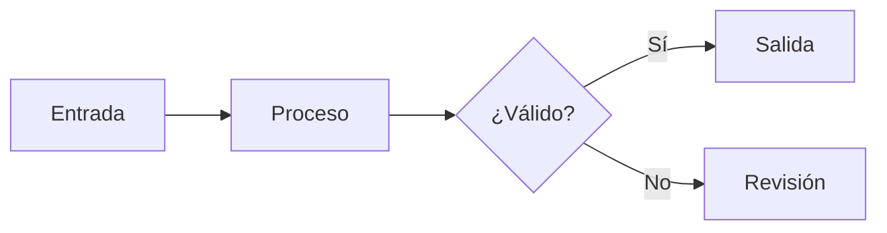

# Referencia de capacidades

Sintaxis y componentes disponibles

<div class="abs-br m-6 opacity-60 text-xs">
  demo.md · pnpm dev:demo
</div>

---
layout: default
---

# Iconos

Sintaxis: `<coleccion-nombre />`

<div class="grid grid-cols-4 gap-6 pt-6 text-center text-sm">
  <div>
    <mdi-lightbulb-on class="text-4xl text-amber-400" />
    <div>mdi</div>
  </div>
  <div>
    <lucide-layout-grid class="text-4xl text-emerald-400" />
    <div>lucide</div>
  </div>
  <div>
    <logos-slidev class="text-4xl text-blue-400" />
    <div>logos</div>
  </div>
  <div>
    <twemoji-star class="text-4xl" />
    <div>twemoji</div>
  </div>
  <div>
    <simple-icons-github class="text-4xl" />
    <div>simple-icons</div>
  </div>
  <div>
    <carbon-chart-line class="text-4xl text-blue-400" />
    <div>carbon (incluida)</div>
  </div>
  <div>
    <ph-check-circle class="text-4xl text-emerald-400" />
    <div>ph (incluida)</div>
  </div>
</div>

<div class="text-xs opacity-60 pt-6">
  También incluida: <code>svg-spinners</code> (iconos animados).
</div>

---
layout: default
---

# Matemática

Ecuación en bloque:

$$
f(x) = \frac{1}{\sigma\sqrt{2\pi}} \, e^{-\frac{(x-\mu)^2}{2\sigma^2}}
$$

Inline: el valor máximo se alcanza en $x = \mu$.

<v-click>

$$
\int_{-\infty}^{\infty} f(x)\,dx = 1
$$

</v-click>

---
layout: default
---

# Diagramas



---
layout: default
---

# Código resaltado por clic

```ts {2|3-4|all}
const items = [1, 2, 3]
const double = items.map(n => n * 2)
const total = double.reduce((sum, n) => sum + n, 0)
console.log(total)
```

<div class="text-xs opacity-60 pt-4">
  La secuencia <code>{2|3-4|all}</code> avanza con cada clic y termina en <code>all</code>.
</div>

---
layout: default
---

# Magic move

````md magic-move
```ts
const value = read();
```
```ts
const value = read();
const clean = normalize(value);
```
```ts
const value = read();
const clean = normalize(value);
const ready = clean !== null;
```
````

---
layout: default
---

# Animaciones de contenido

<v-clicks>

- Primer punto
- Segundo punto
- Tercer punto

</v-clicks>

<v-click>

<div class="mt-6 p-4 rounded bg-emerald-500/10 border-l-4 border-emerald-400">
  Este bloque aparece con el cuarto clic.
</div>

</v-click>

---
layout: two-cols-header
---

# Dos columnas con encabezado

::left::

**Columna izquierda**

- Comparación lado a lado

::right::

**Columna derecha**

- Información complementaria

---
layout: fact
---

# 100 %

Texto de apoyo de la cifra

---
layout: statement
---

# Una idea por slide

Si necesitas dos ideas, son dos slides

---
layout: quote
---

# "Lo simple es lo más difícil de conseguir"

— Autor de la cita

---
layout: end
---

# Fin

`demo.md` · referencia de sintaxis
