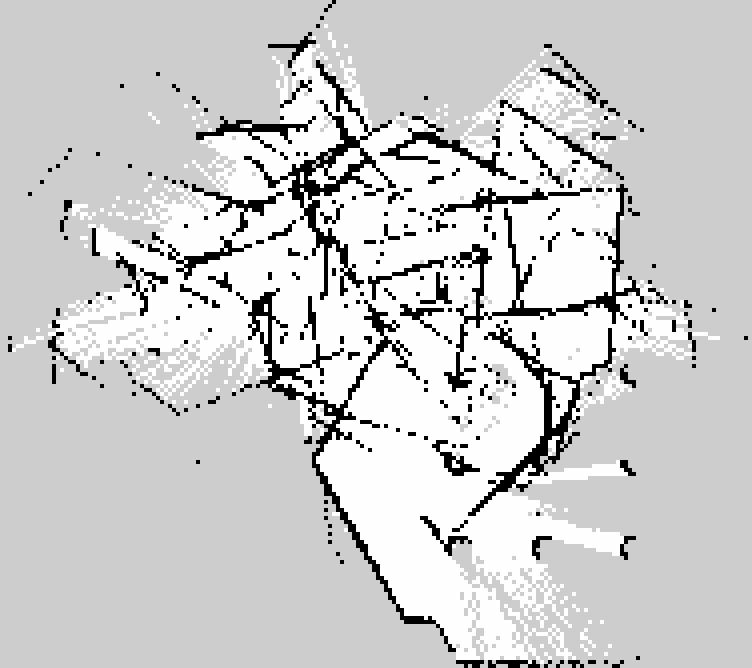
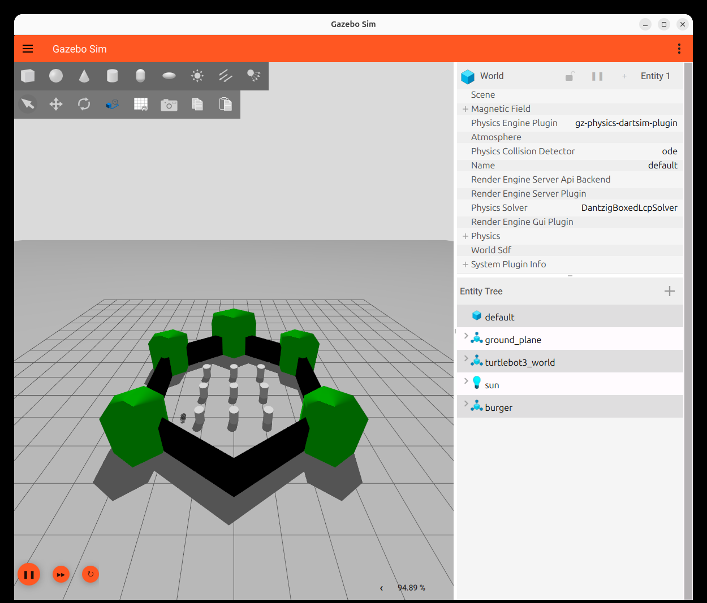
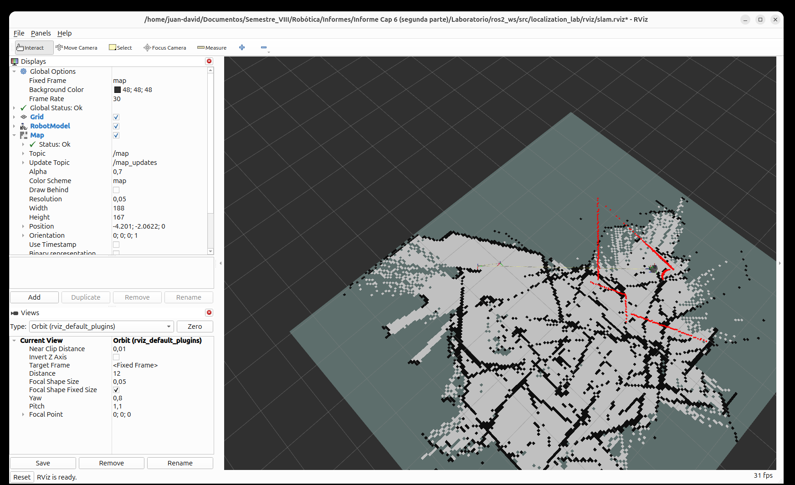

# Informe Capítulo 6 — Segunda parte
## Parte 8: SLAM con Cartographer / SLAM Toolbox en ROS 2

**Estudiantes:** Jhon Hesneydert Londoño · Juan David Villota
**Asignatura:** Robótica — UNAL Manizales, Semestre VIII, 2026-2
**Entorno:** Ubuntu 26.04 · ROS 2 *lyrical* · Gazebo Harmonic 10.5 · TurtleBot3 Burger
**Guía:** `GUÍA DE LABORATORIO CAP6`, sección 8 (pp. 10–21)

---

## 1. Resumen

Se implementó el pipeline completo de SLAM del TurtleBot3 sobre ROS 2:
el LiDAR publica `/scan`, un nodo de SLAM construye la grilla de ocupación
`/map` y publica la transformación `map→odom`, y un controlador mueve el robot
publicando en `/cmd_vel`. El mapa se visualizó en RViz2 y se guardó con
`map_saver_cli` en formato `.pgm` + `.yaml`.

La guía está escrita para Ubuntu 24.04 + ROS 2 **Jazzy** + Cartographer. En el
equipo la distro instalada es **lyrical**, para la cual `cartographer_ros` no
está publicado; el rol de Cartographer lo cumple **SLAM Toolbox 2.10.0**, que
produce el mismo `/map` y el mismo TF `map→odom`. Los archivos de Cartographer
(`cartographer.lua`, `cartographer.launch.py`) se conservan en el paquete para
reproducir la guía literal en un equipo con Jazzy.

**Resultado:** mapa de **9.40 × 8.35 m** (188 × 167 celdas a 5 cm), con
2308 celdas ocupadas, 9560 libres y 19528 desconocidas, construido en 90 s de
recorrido circular, más las capturas de Gazebo y RViz2.

## 2. Objetivos

1. Montar el paquete `localization_lab` con el nodo controlador, el launch de
   SLAM y la configuración del algoritmo (§8.7–§8.14).
2. Verificar el pipeline de tópicos y transformaciones: `/scan`, `/odom`,
   `/cmd_vel`, `/map`, TF `map→odom`.
3. Construir el mapa del entorno y guardarlo en disco (§8.25).
4. Documentar las diferencias entre la guía (Jazzy + Cartographer) y el
   entorno real (lyrical + SLAM Toolbox).

## 3. Marco teórico

### 3.1 SLAM

SLAM (*Simultaneous Localization and Mapping*) resuelve dos problemas a la vez:
estimar la trayectoria del robot y el mapa del entorno, cuando **no se conoce
ninguno de los dos**. Es el caso real del TurtleBot3: la odometría deriva y el
mapa no existe. La formulación probabilística es

$$
p(x_{1:t}, m \mid z_{1:t}, u_{1:t})
$$

donde $x_{1:t}$ es la trayectoria, $m$ el mapa, $z_{1:t}$ las observaciones del
LiDAR y $u_{1:t}$ las acciones de control. En las partes 1–4 del capítulo se
resolvió con un EKF sobre un mapa de *landmarks*; acá se resuelve sobre una
**grilla de ocupación** con un enfoque de *scan matching* y optimización de
grafo de poses.

### 3.2 Grilla de ocupación

El mapa es una matriz de celdas de 5 cm. Cada celda guarda la probabilidad de
estar ocupada. `map_saver_cli` la escribe en modo *trinary*: `0` ocupada,
`254` libre y `205` desconocida. La ventaja frente al mapa de landmarks de la
parte 3 es que no hace falta detectar objetos: se modela cualquier geometría.

### 3.3 Cartographer y su equivalente

Cartographer (Google) construye **submapas** locales con *scan matching* y los
une con un **grafo de poses** que cierra lazos cuando el robot vuelve a un
lugar conocido. Sus tres parámetros críticos en `cartographer.lua` son:

| Parámetro | Valor | Por qué |
|---|---|---|
| `tracking_frame` | `base_scan` | frame del LiDAR: es el sensor con el que se sigue la pose |
| `provide_odom_frame` | `true` | Cartographer genera `odom` a partir del escaneo, no de las ruedas |
| `use_odometry` | `false` | no se usa la odometría del TurtleBot3 como entrada |

SLAM Toolbox resuelve el mismo problema con *scan matching* (Ceres) y un grafo
de poses; su equivalente a los submapas es el grafo
`/slam_toolbox/graph_visualization` y su mapa se publica igual en `/map`. Los
parámetros usados (`slam_toolbox.yaml`) replican los del `.lua`: `resolution`
0.05 m, `min_laser_range` 0.12 m, `max_laser_range` 3.5 m (LDS-01 del burger),
`map_frame: map`, `odom_frame: odom`, `base_frame: base_footprint`.

## 4. Desarrollo

### 4.1 Mapa de pasos de la guía

| Paso | Qué pide | Estado | Dónde |
|---|---|---|---|
| 8.1 | Verificar distro | hecho (`lyrical`, no jazzy) | — |
| 8.2–8.4 | Dependencias, TurtleBot3, Gazebo Harmonic | hecho (`ros-lyrical-*`) | `README.md` |
| 8.5 | Instalar Cartographer | **no existe para lyrical** | sustituido por SLAM Toolbox |
| 8.6 | Instalar Navigation2 | hecho | `nav2_map_server` |
| 8.7–8.9 | Workspace y paquete `localization_lab` | hecho | `ros2_ws/src/localization_lab` |
| 8.10 | Nodo `simple_controller` | hecho (+ `use_sim_time` y velocidades por parámetro) | `localization_lab/simple_controller.py` |
| 8.11–8.12 | `setup.py` y `package.xml` | hecho (entry point corregido) | paquete |
| 8.13 | Configuración de Cartographer | hecho (`cartographer.lua`) + `slam_toolbox.yaml` | `config/` |
| 8.14 | Launch file | hecho (`cartographer.launch.py` + `slam_toolbox.launch.py`) | `launch/` |
| 8.15–8.17 | Compilar, cargar entorno, `TURTLEBOT3_MODEL` | hecho | — |
| 8.18–8.19 | Gazebo y verificación de tópicos | hecho (`turtlebot3_world`) | `evidencias/logs/topics.txt` |
| 8.20 | Ejecutar controlador | hecho | `evidencias/logs/controller.log` |
| 8.21 | Ejecutar Cartographer | hecho con SLAM Toolbox | `evidencias/logs/slam_toolbox.log` |
| 8.22–8.23 | RViz2 con `/map`, `/scan`, `/tf` | hecho | `evidencias/rviz_slam.png` |
| 8.24–8.25 | Resultado y guardado del mapa | hecho (`.pgm` + `.yaml`) | `evidencias/mapa_turtlebot3.*` |

### 4.2 Controlador

`simple_controller` publica a 10 Hz en `/cmd_vel` un `TwistStamped` con
`linear.x = 0.2 m/s` y `angular.z = 0.1 rad/s`, lo que describe una
circunferencia de radio

$$
r = \frac{v}{\omega} = \frac{0.2}{0.1} = 2\ \text{m}
$$

El sello de tiempo se toma del reloj de simulación (`use_sim_time:=true` por
defecto), condición necesaria para que TF acepte los mensajes con el reloj de
Gazebo. Las velocidades son parámetros (`linear_speed`, `angular_speed`), de
modo que se puede cambiar el radio sin editar el código.

### 4.3 Ejecución

Cinco terminales: Gazebo (`turtlebot3_world`), SLAM Toolbox, controlador,
RViz2 y `map_saver_cli`. Los comandos exactos están en
`Laboratorio/README.md`. Se usó `turtlebot3_world` y no `empty_world` porque
este último no tiene paredes: el LDS-01 entrega `inf` en los 360 haces y el
mapa queda sin celdas ocupadas.

## 5. Resultados

### 5.1 Pipeline

| Elemento | Verificación |
|---|---|
| `/scan` | 4.31–4.39 Hz, 360 haces, rango 0.12–3.5 m |
| `/cmd_vel` | `geometry_msgs/msg/TwistStamped`, 10 Hz |
| `/map` | `nav_msgs/msg/OccupancyGrid`, QoS *transient local*, 1 publicador |
| TF `map→odom` | publicada por el nodo de SLAM (ej. $t = (-0.319,\ 2.214)$, $\psi = 41.4^\circ$) |
| Nodos | `slam_toolbox`, `simple_controller`, `robot_state_publisher`, `parameter_bridge` |

### 5.2 Mapa

| Métrica | Valor |
|---|---|
| Resolución | 0.05 m/celda |
| Tamaño | 188 × 167 celdas → **9.40 × 8.35 m** |
| Origen | $(-4.802,\ -2.062)$ m |
| Celdas ocupadas | 2308 (7.4 %) |
| Celdas libres | 9560 (30.4 %) |
| Celdas desconocidas | 19528 (62.2 %) |
| Tiempo de mapeo | 90 s |

El 62 % desconocido es esperable: el robot recorrió un círculo de 2 m de radio
y el LiDAR ve 3.5 m, así que solo se mapeó el anillo barrido. Las zonas
desconocidas son el exterior de ese anillo y el interior que quedó a espaldas
del robot.

### 5.3 Capturas

**Gazebo** — robot en el mundo con obstáculos:

**RViz2** — mapa construido, nube LiDAR y TF:

En RViz2 se ven el `/map` en gris, la nube del LiDAR en rojo, el modelo del
robot y el TF. El display `/submap_list` del `.rviz` no publica nada porque es
exclusivo de Cartographer (anomalía A17).

## 6. Análisis

- **El mapa coincide con el mundo en lo grueso.** Los cilindros del símbolo ROS
  y las paredes del fondo aparecen en su posición, pero hay trazos dobles y
  zonas borrosas: el robot choca contra los cilindros, las ruedas patinan y la
  odometría se degrada. El *scan matching* corrige en parte, no del todo.
- **El TF `map→odom` no es la pose del robot, es la corrección.** El nodo de
  SLAM no mueve el robot en el mapa: publica la transformación que lleva el
  frame `odom` (deriva) al frame `map` (corregido). En la corrida esa
  corrección llegó a saltar de $(-0.657,\ 1.987)$ a $(-2.106,\ 2.012)$ en
  0.8 s: el robot avanzó 0.16 m, así que el resto fue el algoritmo corrigiendo
  la deriva acumulada.
- **Diferencia con las partes 1–4.** Ahí el estado era la pose (y los
  landmarks) con covarianza explícita; acá el mapa es una grilla y la
  incertidumbre no se publica como matriz. La ventaja es que no hace falta un
  mapa de landmarks conocido; el costo es que el mapa es denso y la
  complejidad crece con el área.
- **Limitación del recorrido.** Con un círculo de radio fijo el robot no
  explora; para mapear el mundo completo hace falta teleoperar o usar
  `explore_lite`/Nav2. Eso excede la parte 8 y queda para la parte 9.
- **Cartographer vs. SLAM Toolbox.** El resultado observable es el mismo
  (`/map` + TF `map→odom`); cambian los submapas y el archivo de configuración.
  La guía no se puede seguir al pie de la letra en lyrical por una limitación
  de empaquetado, no de concepto.

## 7. Anomalías y adaptaciones

| # | Guía | Equipo | Solución |
|---|---|---|---|
| A1 | Jazzy | lyrical | `ros-jazzy-*` → `ros-lyrical-*` |
| A2 | `ros2 --version` | no existe | `echo $ROS_DISTRO` |
| A3 | Cartographer | no publicado | SLAM Toolbox + launch equivalente |
| A4 | copiar `.lua` base | ruta inexistente | no se copiaron; los resuelve el paquete |
| A5 | `console_scripts` vacío | `ros2 run` falla | entry point agregado |
| A7 | `/cmd_vel` `Twist` | `TwistStamped` | el nodo ya usa `TwistStamped` |
| A12 | GUI de Gazebo | `on_exit_shutdown` | no cerrar el cliente con el servidor corriendo |
| A14 | numeración con salto | pasos 9 y 10 inexistentes | renumerado 8.1–8.26 |
| A16 | `empty_world` | mapa vacío | usar `turtlebot3_world` |
| A17 | `/submap_list` | no existe sin Cartographer | usar `/slam_toolbox/graph_visualization` |

## 8. Conclusiones

1. Se montó el pipeline real de SLAM del TurtleBot3 y se obtuvo un mapa
   métricamente coherente (5 cm/celda) del entorno simulado.
2. La sustitución de Cartographer por SLAM Toolbox es transparente para el
   resultado: mismo `/map`, mismo TF, mismo comando de guardado.
3. La verificación de tópicos y TF es la parte que más falla en la práctica:
   sin `use_sim_time` o sin `TURTLEBOT3_MODEL` el pipeline arranca pero no
   publica nada útil.
4. El mapa guardado (`.pgm` + `.yaml`) es el insumo de la localización con
   AMCL y de la navegación con Nav2: cierra el ciclo SLAM → localización →
   planificación del capítulo 6.

## 9. Referencias

- Corke, P. *Robotics, Vision and Control*, 3rd ed., Springer 2023, cap. 6.
- `GUÍA DE LABORATORIO CAP6`, sección 8 (pp. 10–21).
- ROS 2 Documentation — *SLAM Toolbox*; Cartographer ROS.
- `slam_toolbox` 2.10.0, `nav2_map_server`, `turtlebot3_gazebo` 2.3.7.

## 10. Checklist de entrega

- [x] Paquete `localization_lab` compilado (`colcon build`).
- [x] Nodo controlador publicando `TwistStamped` a 10 Hz.
- [x] `/scan`, `/odom`, `/tf`, `/cmd_vel` verificados.
- [x] `/map` publicado y visualizado en RViz2.
- [x] Captura de Gazebo con el robot en movimiento.
- [x] Captura de RViz2 con `/map`, `/scan` y TF.
- [x] `mapa_turtlebot3.pgm` + `mapa_turtlebot3.yaml` guardados.
- [ ] Presentación y sustentación de la parte 8.
